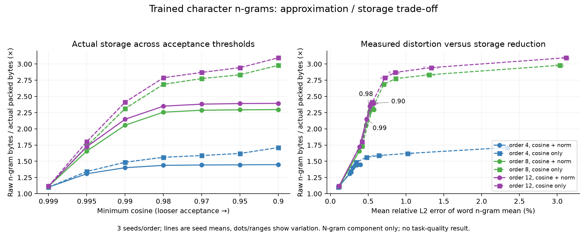
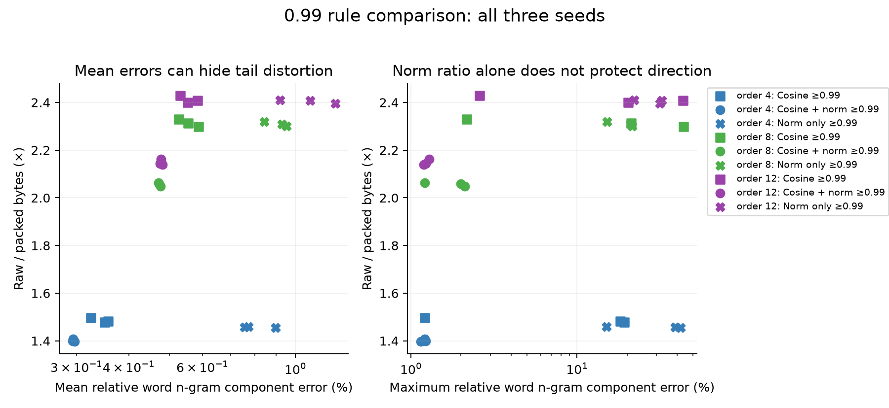

# Approximate n-gram row sharing: storage / distortion curves — 2026-10-18

**Category: approximate compression of public-text trained character-ngram SGNS.**
This extends the [lossless reference](trained_ngram_similarity_20261018.md) using
the same nine frozen tables, without retraining or changing source weights.
Random vectors are not the evaluation population. It is not original C++ export
reproduction, Engram checkpoint evaluation, or held-out model quality.

With cosine **≥0.99**, actual n-gram artifacts shrink **2.40–2.43×** at max
order 12. Requiring **norm ratio ≥0.99 as well** gives **2.14–2.16×** with
mean relative error of the word n-gram component around **0.48%** and worst
error **1.29%**. These are vector distortion metrics, not accuracy loss.

The norm constraint is useful: cosine-only accepts nearly aligned vectors of
different lengths. Norm-only has the complementary problem: similar lengths
can have very different directions. The joint rule offers a measured compromise.

[All 135 cases](cosine_merge_evidence_20261018/report.json) |
[Curve CSV](cosine_merge_evidence_20261018/curve.csv) |
[Environment/hashes](cosine_merge_evidence_20261018/provenance.json) |
[Tests](cosine_merge_evidence_20261018/tests.txt)

## Curves



[Vector SVG](cosine_merge_evidence_20261018/cosine_tradeoff.svg) ·
[PDF](cosine_merge_evidence_20261018/cosine_tradeoff.pdf)

Solid: cosine plus norm ratio; dashed: cosine only. Lines are means over seeds
3/7/11; dots and bands show seed variation, not confidence intervals over
languages/checkpoints. Threshold spacing on the left is categorical. The right
panel uses actual relative L2 error, because cosine 0.98 does **not** mean 2%
reconstruction loss. Curve segments connect measured settings and are not
continuous/error guarantees.

The norm ratio stays at 0.99 while cosine thresholds vary through
0.999/0.995/0.99/0.98/0.97/0.95/0.90. At order 12 the joint rule has a useful
storage bend around 0.98; loosening beyond it produces little extra storage
benefit and larger tail distortion. This is a candidate setting for further
task validation, not a universal optimum.

| Cosine threshold | Order-12 joint rule compression, seed mean | Mean word n-gram relative L2, seed mean | Worst seed p95 | Worst individual word error |
| --- | --- | --- | --- | --- |
| 0.999 | 1.116× | 0.114% | 0.439% | 0.809% |
| 0.995 | 1.725× | 0.386% | 0.762% | 1.288% |
| 0.99 | 2.148× | 0.478% | 0.801% | 1.288% |
| 0.98 | 2.350× | 0.522% | 0.837% | 3.791% |
| 0.97 | 2.381× | 0.535% | 0.849% | 3.791% |
| 0.95 | 2.391× | 0.547% | 0.871% | 5.341% |
| 0.9 | 2.393× | 0.572% | 1.137% | 5.341% |

## What 0.99 saves, and which errors it permits

Compression factors below include the actual `.men` header, forwarding map,
block descriptors, zlib/raw payload **and approximation manifest**. Their
denominator is original float32 n-gram row bytes. Keys/trie, word/output rows
and the rest of a model are excluded; these are not full-model compression
factors or measured RAM savings. The raw reconstructed `.f32` file is builder
input and not part of the serving artifact.

| Max order | Seed | Rule | Retained rows | Raw / packed | All-row mean relative L2 | All-row maximum relative L2 | Word n-gram mean relative L2 | Word n-gram maximum relative L2 |
| --- | --- | --- | --- | --- | --- | --- | --- | --- |
| 4 | 3 | norm ≥0.99 only | 3,817 | 1.460× | 2.93% | 160.28% | 0.772% | 15.05% |
| 4 | 3 | cosine ≥0.99 | 3,754 | 1.483× | 2.37% | 57.81% | 0.357% | 18.27% |
| 4 | 3 | cosine + norm ≥0.99 | 3,992 | 1.397× | 1.89% | 14.21% | 0.296% | 1.14% |
| 4 | 7 | norm ≥0.99 only | 3,829 | 1.455× | 2.72% | 131.05% | 0.896% | 41.98% |
| 4 | 7 | cosine ≥0.99 | 3,722 | 1.496× | 2.40% | 14.26% | 0.325% | 1.21% |
| 4 | 7 | cosine + norm ≥0.99 | 3,962 | 1.407× | 1.94% | 14.09% | 0.294% | 1.21% |
| 4 | 11 | norm ≥0.99 only | 3,824 | 1.457× | 2.76% | 159.17% | 0.755% | 38.89% |
| 4 | 11 | cosine ≥0.99 | 3,769 | 1.477× | 2.33% | 60.93% | 0.350% | 19.32% |
| 4 | 11 | cosine + norm ≥0.99 | 3,987 | 1.399× | 1.89% | 14.13% | 0.293% | 1.23% |
| 8 | 3 | norm ≥0.99 only | 5,998 | 2.309× | 5.46% | 139.12% | 0.928% | 21.11% |
| 8 | 3 | cosine ≥0.99 | 6,020 | 2.298× | 4.64% | 168.52% | 0.588% | 43.76% |
| 8 | 3 | cosine + norm ≥0.99 | 6,787 | 2.048× | 3.99% | 14.21% | 0.476% | 2.10% |
| 8 | 7 | norm ≥0.99 only | 6,016 | 2.301× | 5.50% | 147.78% | 0.952% | 21.49% |
| 8 | 7 | cosine ≥0.99 | 5,936 | 2.330× | 4.65% | 14.59% | 0.527% | 2.16% |
| 8 | 7 | cosine + norm ≥0.99 | 6,736 | 2.063× | 4.01% | 14.24% | 0.471% | 1.21% |
| 8 | 11 | norm ≥0.99 only | 5,970 | 2.318× | 5.49% | 142.61% | 0.844% | 15.19% |
| 8 | 11 | cosine ≥0.99 | 5,979 | 2.313× | 4.70% | 65.81% | 0.555% | 21.23% |
| 8 | 11 | cosine + norm ≥0.99 | 6,749 | 2.059× | 4.07% | 14.20% | 0.473% | 1.99% |
| 12 | 3 | norm ≥0.99 only | 6,044 | 2.408× | 5.58% | 171.49% | 1.086% | 32.50% |
| 12 | 3 | cosine ≥0.99 | 6,040 | 2.408× | 4.81% | 170.96% | 0.584% | 43.49% |
| 12 | 3 | cosine + norm ≥0.99 | 6,829 | 2.140× | 4.17% | 14.21% | 0.482% | 1.19% |
| 12 | 7 | norm ≥0.99 only | 6,038 | 2.410× | 5.52% | 131.85% | 0.920% | 22.12% |
| 12 | 7 | cosine ≥0.99 | 5,984 | 2.429× | 4.74% | 20.05% | 0.531% | 2.59% |
| 12 | 7 | cosine + norm ≥0.99 | 6,756 | 2.162× | 4.17% | 14.22% | 0.477% | 1.29% |
| 12 | 11 | norm ≥0.99 only | 6,078 | 2.395× | 5.37% | 160.66% | 1.245% | 31.44% |
| 12 | 11 | cosine ≥0.99 | 6,062 | 2.399× | 4.73% | 62.12% | 0.554% | 20.27% |
| 12 | 11 | cosine + norm ≥0.99 | 6,817 | 2.143× | 4.16% | 14.19% | 0.475% | 1.23% |

**Averages must not hide merged-row error.** At cosine/norm 0.99, merged
order-12 rows have mean relative L2 around 8.0%; the all-row mean is around
4.2% because retained rows have zero error. Aggregating many n-grams into
each word greatly reduces the mean-component change. Raw evidence separates
all rows, changed rows and frequency-weighted metrics, with p95/max/norm change.

Cosine-only order-12 cases have row maximum errors up to **171%**, despite
every reconstructed row satisfying cosine ≥0.99. Adding norm ratio bounds
row maximum error to about **14.2%**. The resulting word component error
maximum falls from up to **43.5%** to **1.29%** at order 12.



[SVG](cosine_merge_evidence_20261018/norm_rule_comparison.svg) ·
[PDF](cosine_merge_evidence_20261018/norm_rule_comparison.pdf)

The norm-only structural control obtains similar compression but allows
negative cosine (down to about -0.485) and word component errors up to 42%.
It therefore does not establish the published legacy norm-only callback as a
sufficient preservation rule. This control restricts candidates to actual
prefix/suffix ancestors and chooses the highest norm ratio; the legacy callback
has different traversal and no explicit structural check. It is a diagnostic
of that criterion, not a reproduction of old paper/export numbers.

## Reconstruction and measurement contract

Process keys shortest-first, with lexical ties. For each original row, consider
**retained proper prefix/suffix ancestors** of length at least two. Select the
highest qualifying cosine; the norm-only control selects highest norm ratio.
Representatives retain their original vectors and never move. Directly compare
every original row to its final representative; no transitive threshold shortcut
or chain of approximate replacements is allowed. Zero rows are retained. This
greedy policy uses spelling and learned vectors, not training signatures. It is
not global clustering or a maximum-compression solver.

Construct the approximated table via original-ID → representative-ID mapping,
then use exact dedup/native block storage on those reconstructed bytes. An
`APPROXIMATION.json` sidecar explicitly records source/reconstructed hashes,
thresholds, dtype and approximate status. Every native row is verified against
the **approximated table**, not against original vectors. No change is made to
the default lossless exporter or legacy C++ callback.

For a row, relative L2 = `||reconstructed - original|| / ||original||`. Cosine
and norm tests use float64 on original float32 rows. With cosine c and relative
length r, squared relative error is `1 + r² - 2rc`; cosine alone does not bound
r. At c≥0.99 and norm ratio≥0.99, the geometric worst case is about 14.25%.

“Word n-gram component” averages **only the word’s n-gram rows**, preserving
multiplicity. The training run did not export its separate word row or output
weights. Consequently this is not a full FastText word vector, sentence metric,
SGNS loss, nearest-neighbor accuracy, logits or benchmark task. The high fidelity
of averages must not be substituted for downstream quality.

## Reproduce

Benchmark commit: `963db4427a5f6d3ca065c272024bb37101948944`. Training commit:
`ba564539489c44ff2582a7d83039a57c7dde7b9e`. Exact command and hashes are in the report.
Python 3.12.14, PyTorch 2.14.1, NumPy 2.5.4; Apple M5, 10 logical CPUs, 32 GiB,
macOS 26.6.2 arm64; one torch/interop thread, CPU only. Native library built
with Apple clang 21.0.0. Local compute; no paid API/rented compute or monetary/
energy estimate. Source dataset license was not established; raw text and learned
tables are not redistributed. Previous trained corpus provenance is linked above.

```bash
make native NATIVE_SHARED=-dynamiclib NATIVE_EXT=dylib
# First reproduce the trained reference from the linked lossless study.
python tools/benchmark_cosine_merge.py \
  --training-dir artifacts/native-ngram-20261018/trained-reference \
  --corpus artifacts/native-ngram-20261018/corpus/tinyshakespeare.txt \
  --native-library build/libmeft_rows.dylib \
  --output-dir artifacts/native-ngram-20261018/cosine-merge-final \
  --thresholds 0.999,0.995,0.99,0.98,0.97,0.95,0.90
python -m pip install matplotlib
python tools/plot_cosine_merge.py \
  --report artifacts/native-ngram-20261018/cosine-merge-final/report.json \
  --output-dir docs/cosine_merge_evidence_20261018
python -m unittest discover -s tests
```

Linux uses `make native` and `.so`. The figures require only aggregate JSON
plus matplotlib/NumPy; no corpus/weights are needed to redraw them. The plotting
script records its commit/environment separately. 24 tests pass with torch/NumPy;
new cases cover transitive drift, norm mismatch, opposite directions, suffix
matching and unrelated keys. Full sweep checks native equality and direct
cosine/norm bounds across all 135 cases. Earlier implementation runs were
superseded after adding the norm-only control and approximation-manifest byte
accounting; final evidence includes every order/seed/policy/threshold.

The next acceptance study should freeze a licensed complete model, retain its
word/output/gating weights, and measure held-out quality and serving costs
under an explicit distortion budget. No “negligible task loss” conclusion is
drawn from these vector-only curves.
