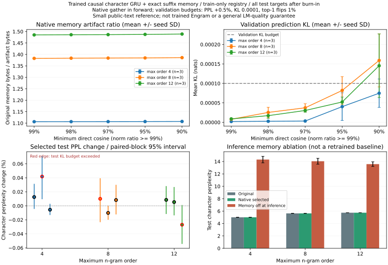

# Native compression in a trained causal language model

The [model](../../tools/causal_ngram_lm.py) adds exact learned character-suffix
memory to character embeddings, followed by a one-layer GRU and a full 62-class
softmax (including an explicit unknown-character class). Only suffixes ending
at the input character are queried; the next character is the prediction target.
Characters and keys fit training text only. Keys need three training occurrences;
missing held-out keys use zero memory. Native `MappedEmbedding` replaces the
memory module **inside the actual forward path**, with recurrent state carried
across evaluation chunks. No post-compression retraining.

The [runner](../../tools/benchmark_causal_lm_compression.py) uses the first 131072
characters of pinned TinyShakespeare, split into 104857/13107/13108 train/val/test
characters. All next-character targets after a common 64-character burn-in are
scored, including unknown targets; there happened to be none in this test slice.
Validation chooses maximum artifact compression within +0.5% PPL, mean KL <=
0.0001 nats and <=1% top-1-flip budgets. Test evaluates that choice only.

| Max order | Selected memory artifact ratio | Parameters + registry ratio | Original test char PPL | PPL with memory disabled at inference |
|---|---:|---:|---:|---:|
| 4 | 1.107x | 1.099x | 5.005 | 14.312 |
| 8 | 1.385x | 1.359x | 5.636 | 14.044 |
| 12 | 1.489x | 1.453x | 5.741 | 13.578 |

Means across seeds 3/7/11. Ratio denominators include native table, adapter
metadata and approximation manifest; the second ratio also counts unchanged
model parameters and the serialized lookup registry on both sides. Runtime
dictionaries, framework and resident memory are not counted. Memory-off is an
inference ablation of this trained model, not a separately trained baseline.

**Lossless native storage preserved validation/test logits and cross-entropy
bit for bit in all nine models.** Approximate chosen variants changed test PPL
by -0.02696% to +0.04183%, and top-1 choices by at most 0.18401%.
**Three of nine test models exceeded the validation mean-KL budget**:
order 4/seed 7, order 8/seed 3, order 12/seed 11. They are preserved in
[audit.json](audit.json), with no test-set reselection. Small average PPL changes
do not guarantee small changes at every position; per-position tails are in raw
metrics. Relaxing cosine adds little compression here while raising validation
KL. Higher order compresses better, but has worse original PPL under this fixed
training budget; these are distinct findings.



[report.json](report.json) records code SHA, exact command, corpus/split/state/key
hashes, per-seed results, software/hardware and limitations. Run: M5 CPU, 1/1
threads, Python 3.12.14 / PyTorch 2.14.1, dim 64, 1200x16x32 training targets per
model, Adam dense lr 0.002 and SparseAdam memory lr 0.01. Standard averaged-memory
gradients. All retained rows changed during training. Local cached text, no paid
services; finite training, one small corpus, no convergence guarantee. This is
a character-GRU reference, not trained Engram or a downstream Transformer test.
Corpus licensing has not been independently established; text, keys and weights
remain local.

[Run output](run.txt) · [52 local tests](local-tests.txt) · [Native rebuild](native-build.txt).
Replay the exact command in JSON using the pinned corpus. Generate the derived
audit/figure (plotting needs optional matplotlib):

```bash
python tools/analyze_causal_lm_compression.py --report REPORT \
  --json-out AUDIT.json --plot-out FIGURE.png
```
