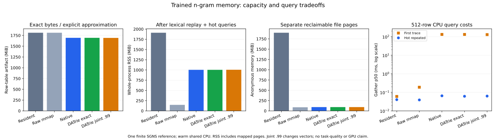

# CPU capacity on 1.85 million actually updated n-gram rows

This run scales the storage reference to **1,855,907 distinct n-gram keys ×
256 float32 values: 1,900,448,768 bytes**. Every exported row changed from its
initialization and is finite. The complete original-ID reconstruction passes
for ordinary native and DATrie exact storage. The measured tradeoff is useful:
DATrie reduces index size, but the current 256-row native blocks cause severe
read amplification on sparse access. Raw mmap is the stronger CPU serving
control in this workload. These are storage results, not a trained Engram or
whole-model memory/quality benchmark.

## Training provenance

The public [enwik8 archive](https://mattmahoney.net/dc/enwik8.zip) contains
100,000,000 bytes of Wikipedia-derived benchmark XML. Split its raw bytes 90/10
before preprocessing, strip XML tags, lowercase ASCII words of length 2–64,
and retain training words occurring at least twice. The training registry has
142,308 words and 1,860,921 exact character n-grams of orders 2–12. A sparse CPU
SGNS reference uses dimension 256, five negatives, seed 42, four threads,
three finite epochs and 1,212,126 sampled adjacent pairs. Each epoch includes
one eligible occurrence per center plus 262,144 sampled adjacent pairs;
this overweights rare centers and is explicitly not ordinary full-corpus SGNS.
It retains the earlier reference's averaged forward / unaveraged bag-gradient
convention. Training is finite, not a convergence or task-quality result.

The [first run](training-rejected.json) rejected the export because 5,014 rows
still equaled initialization. The [follow-up](training.json) explicitly uses
`--exclude-untrained`, records the excluded 0.2694% and exports the changed-row
subset with its original training-ID provenance. This is a separately registered
storage table, not a full-model converter silently deleting memory rows. The
initialization, trained table, source-ID map, corpus and query fingerprints are
recorded; text and weights remain local and are not redistributed.

## Storage and construction

| Serving row table | Bytes | Saving vs raw rows | Extra saving vs ordinary native | Export seconds |
| --- | ---: | ---: | ---: | ---: |
| Raw float32 | 1,900,448,768 | — | — | — |
| Ordinary native XOR | 1,776,985,765 | 6.50% | — | 227.24 |
| DATrie exact native | 1,776,985,765 | 6.50% | 0% | 259.15 |
| DATrie joint 0.99/0.99 | 1,774,861,130 | 6.61% | 0.12% | 273.53 |

The original production prefix/suffix planner and mark-compact bridge are used
for exact/joint variants. Exact merges zero rows; joint merges 2,130 rows.
Ordinary and exact native artifacts have identical bytes. Flat keys occupy
43,700,463 bytes; DATrie occupies 14,848,048 bytes, **66.02% smaller**, returning
the same original IDs. Index plus ordinary-native savings are **1.58%** relative
to flat keys plus ordinary native, because vectors dominate this wider table.
These index figures do not establish large-table lookup speed.

Joint sharing is approximate: maximum per-row relative L2 error is **14.24%**,
and global relative L2 is **0.518%**. Its query oracle contains representative
bytes, not the unchanged original vectors. No task loss or model logits were
evaluated. This shallow, long-tail table's small joint benefit cannot be used
to generalize the earlier small-reference compaction gains or to reject gains
after a different training schedule.

Ordinary streaming export peaks at 43.1 MiB process RSS. Structural build/export
peaks at approximately 4,817 / 5,001 MiB for exact/joint: the current planner
loads full vectors and constructs keys/maps. Construction is separate from
fresh reader memory and is not bounded by the 4 MiB serving cache.

## Fresh-process serving controls

All controls write directly to preallocated outputs: NumPy `take(out=...,
mode="clip")` for valid fixture IDs, or C `gather_into`. No Torch is imported by
the capacity workers. Native uses 256-row blocks and a 4 MiB row cache.
Each trace contains up to 65,536 rows in 512-row queries. The lexical trace uses
registered n-grams from the chronological held-out suffix; a separate uniform
ID trace stresses access breadth using genuine trained rows. Only that access
pattern is synthetic. Hot timing repeats the first eight trace queries 20 times.

| Backend | Open RSS MiB | RSS after lexical replay MiB | Anonymous after lexical replay MiB | First lexical trace p50 ms | Hot lexical p50 ms | RSS after uniform stress MiB |
| --- | ---: | ---: | ---: | ---: | ---: | ---: |
| Resident NumPy | 1,847.5 | 1,910.9 | 1,899.6 | 0.060 | 0.0402 | 1,916.9 |
| Raw mmap | 35.1 | 146.7 | 87.2 | 0.188 | 0.0388 | 389.3 |
| Ordinary native | 35.5 | 1,003.7 | 91.7 | 132.033 | 0.0647 | 1,803.9 |
| DATrie exact native | 35.5 | 1,003.7 | 91.7 | 131.842 | 0.0611 | 1,803.9 |
| DATrie joint native | 35.5 | 1,005.7 | 91.7 | 128.866 | 0.0626 | 1,801.8 |

RSS includes mapped file pages; those clean pages are reclaimable, unlike the
resident table's anonymous allocation. All variants also retain roughly 64 MiB
of query-output buffers per trace plus runtime/oracle metadata. The 4 MiB native
budget bounds decoded cached payload, not file residency, output, allocator,
query scratch or total memory. Raw mmap already removes the full anonymous
table allocation. Native touches many more payload pages and decodes entire
blocks for sparse misses; its first uniform trace p50 is about 875 ms versus
0.736 ms for raw mmap. There is no whole-model throughput claim.

The filesystem/page cache is warm from construction and verification. “First
trace” starts with an empty application cache and is **not disk-cold I/O**.
The host is shared, variants have a fixed order, and no significance claim is
made. Memory cgroups are mounted read-only; no hard memory cap or OOM outcome
was tested. Native anonymous allocation is small, but these measurements do
not establish service behavior under reclaim pressure.



## Reproduction and raw evidence

Training/preparation source is `3104f50470067049f5a57a574270d0b9d17c4fbf`.
Final direct-output NumPy controls use
`1e5546a82fea9b19de36ff41a9b27d0785977b34`. Native controls already used the
unchanged direct C query path; their actual source SHAs remain in each worker.
[The preliminary report](preliminary-report.json) preserves the original
extra-copy NumPy controls. [The final report](report.json) replaces those
controls, retains native workers, records exact commands and hashes all source
and native artifacts. The [replay script](final-replay.sh) records that sequence.

Full construction from the final runtime source, with local enwik8:

```sh
export CUDA_VISIBLE_DEVICES=""
export OMP_NUM_THREADS=4 OPENBLAS_NUM_THREADS=1
python -m pip install torch numpy
make native structural-native
python -m tools.train_capacity_memory --corpus-zip /path/to/enwik8.zip \
  --output-dir /path/to/training --order 12 --dim 256 --min-count 2 \
  --epochs 3 --random-pairs 262144 --batch-size 128 --threads 4 --seed 42 \
  --exclude-untrained
python -m tools.benchmark_memory_capacity --training-dir /path/to/training \
  --output-dir /path/to/capacity --native-library build/libmeft_rows.so \
  --structural-library build/libmeft_structural.so --block-rows 256 \
  --cache-bytes 4194304 --query-rows 512 --repeat 20
```

Linux x86-64, AMD EPYC 7742, Python 3.11.15, Torch 2.11.0+cu130 (CPU-only
execution), NumPy 2.2.6, Linux 5.4.0-42. All work stays under
`/llm-align/duyimin/meft-cpu-capacity-20261030`; CUDA visibility is empty and
GPU processes are untouched. Existing shared CPU only; no paid API, new rented
compute or energy/monetary cost measurement. Archive download occurred locally
and was transferred to this directory after the remote proxy denied the site.

[Build](build.txt), [complete train/preparation log](training-and-preparation.log),
[rejected-run log](training-rejected.log), [9 Linux tests](remote-tests.txt),
[35 local targeted tests, 6 platform skips](local-tests.txt), and the small
public-text five-backend smoke run are separate from the large serving evidence.
Software evidence is additional to the original FastText paper, not its
large-corpus reproduction. The next measured engineering target is reducing
block read amplification; the current data does not justify a native capacity
or speed advantage over raw mmap on these CPU traces.
