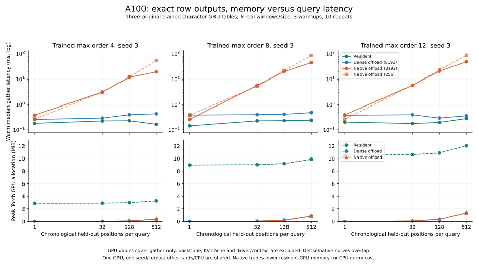

# A100 trained-table gather costs, 2026-10-30

**Real CUDA output bytes match the original trained tables. CPU offload lowers
gather GPU allocation, while native queries are slower than dense offload on
these traces. Native and dense offload have the same measured GPU allocation.**
That separates offload benefits from storage compression benefits.

Three original character-GRU memory tables, trained max orders 4/8/12, seed 3;
11,760 / 36,778 / 43,152 rows × 64 float32 values. These are the
[previously prepared real held-out IDs](../device_gather_preparation_20261030/README.md),
not random vectors, repeated rows, or trained Engram weights. Each size has 8
distinct chronological windows. All slots, including missing-key zeros and
repeated IDs, retain their original addressing. Each mode runs in a separate
process with 1/1 Torch threads, 3 warmup passes and 10 measured passes (80 query
samples per case). Every prepared output matches its original-weight digest.

The controlled modes are device-resident dense, CPU dense offload and CPU native
mmap offload. Offload modes share pinned slots, copy stream/events and output
ownership. Only their CPU readers differ. Native workers never load the dense
source table. Query validation/CPU gather/H2D/device readiness are timed;
correctness D2H/hashing is outside warm timing. Original row data and dtypes
are preserved.

Two staging configurations use 256 or 8,192 rows/slot, both with 2 slots and a
4 MiB native decoded-cache budget. The maximum pinned host allocation is
128 KiB or 4 MiB respectively. Native cache metadata/entry limits are separate:
the current C reader retains at most 64 decoded blocks, so a configured byte
budget does not guarantee that many bytes can be retained. Artifacts here use
64-row blocks; block decoding/cache churn is a candidate for further profiling.
Changing staging alone does not fix the underlying query gap.

| Order, 512 positions | Resident median ms | Dense offload median ms | Native median ms, 256 rows/slot | Native median ms, 8,192 rows/slot |
| --- | ---: | ---: | ---: | ---: |
| 4 | 0.165 | 0.433 | 54.755 | 19.338 |
| 8 | 0.241 | 0.481 | 86.350 | 44.879 |
| 12 | 0.282 | 0.359 | 87.803 | 48.519 |

Resident/dense columns use the 8,192-row run. Larger staging improves the native
512-position median by **2.83× / 1.92× / 1.81×**, but still leaves native about
45× / 93× / 135× slower than dense offload in those specific cases. This is a
negative query-cost result, not an end-to-end model speedup. Smaller windows,
cache-friendly workloads and alternative layouts may behave differently.

At order 12 / 512 positions, peak Torch GPU allocation is **12.043 MiB resident
versus 1.375 MiB for either offload mode**. These are gather-only allocations:
no backbone, KV cache, multi-layer retained outputs or driver/context memory is
included. This is not an 8.8× whole-model memory improvement. CPU RSS includes
framework/CUDA host state, native mmap/cache and staging; it is in raw reports
and does not establish a large-table deployment advantage.

All complete headline runs use physical GPU 7, **A100-SXM4-80GB**, on the
two-EPYC-7742 Linux host described in the [hardware record](../cuda_a100_evidence_20261030/hardware-and-load.json).
Python 3.11.15, PyTorch 2.11.0+cu130, CUDA runtime 13.0, driver 535.54.03;
native C built with `cc -std=c11 -O2 -Wall -Wextra -Werror -fPIC -shared ... -lz`.
Existing local trained checkpoints/corpus, no retraining, downloads or paid
services. Other cards and host CPU/I/O remained shared. The selected card passed
an empty-client/low-utilization gate, and competing clients were checked before
and after each timed case. This is sampled monitoring, not exclusive hardware
reservation or a full utilization trace.

CUDA monitor code at `ca054e8` handles PyTorch's bare UUID versus NVIDIA's `GPU-`
prefix, and different container/driver PID namespaces. A worker's driver PID is
the sole client appearing after the empty-device gate and its context creation;
ambiguous/new clients block the run. Source hashes, exact commands, checkpoint/
fixture hashes, native-library hash, medians, p95, individual timings, GPU
allocation and RSS are in raw reports. Warm page cache is retained; no shared
system page-cache flush occurs. Fixed baseline/config order, one seed/corpus,
small tables and shared host resources limit generalization.

| Order | 256 rows/slot | 8,192 rows/slot |
| --- | --- | --- |
| 4 | [raw report](order-4-stage-256.json) | [raw report](order-4-stage-8192.json) |
| 8 | [raw report](order-8-stage-256.json) | [raw report](order-8-stage-8192.json) |
| 12 | [raw report](order-12-stage-256.json) | [raw report](order-12-stage-8192.json) |

[Summary rows](summary.json) drive
[`plot_cuda_gather.py`](../../tools/plot_cuda_gather.py):
`python -m tools.plot_cuda_gather --evidence-dir docs/cuda_gather_evidence_20261030`.
Plot generation: Python 3.12.14 / Matplotlib 3.11.2, no inference.

Earlier records are retained: [UUID monitor failure](uuid-failed.json),
[card 0 interrupted during the last native case](card0-interrupted.json),
[card 7 occupied at startup](card7-occupied.json), and
[first larger-staging run interrupted](stage8192-interrupted.json).
These interrupted runs are excluded from headline comparisons. The owner
authorized ending the selected card's identified occupancy programs. No
other-card processes or the new card-0 model-calibration job were terminated.
All our benchmark workers exited; no background GPU reservation was installed.

The [trained Qwen end-to-end CUDA measurements](../qwen_cuda_performance_20261030/README.md)
show how the much smaller actual TinyEngram memory behaves inside a Transformer.
