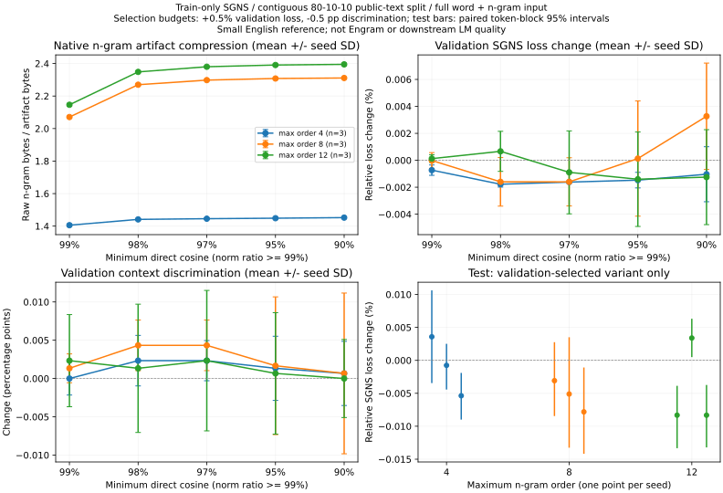

# Native compression with train-separated SGNS quality

The [runnable evaluator](../../tools/benchmark_heldout_compression.py) trains exact
character n-grams **and word rows**, fits vocabulary/counts on training text only,
and measures the full averaged input embedding with unchanged output rows.
Every compressed table is written and decoded through the native C ABI.
Lossless storage preserved every full embedding and both held-out split outputs
bit for bit in all nine models. Approximate sharing changes source vectors.

Three seeds per maximum order, cosine thresholds 99/98/97/95/90%, norm ratio
fixed at 99%, direct immutable proper prefix/suffix representatives, no retraining.
Validation selects maximum compression subject to +0.5% SGNS loss and -0.5
percentage-point discrimination budgets. Test evaluates only that chosen setting.
All nine selected cosine 90% / norm 99%; this is a measured outcome, not a default
quality guarantee. A 90% cosine threshold is not a 10% task-loss budget.

| Max order | N-gram ratio at cosine/norm 99% | Selected n-gram ratio | Selected full vector payload ratio | Test SGNS loss change range |
|---|---:|---:|---:|---:|
| 4 | 1.406x | 1.452x | 1.272x | -0.00538% to +0.00358% |
| 8 | 2.071x | 2.311x | 1.925x | -0.00782% to -0.00308% |
| 12 | 2.146x | 2.395x | 1.989x | -0.00833% to +0.00340% |

Ratios are means over seeds. N-gram artifacts include headers/maps/descriptors
and manifests. Full **vector payload** includes unchanged word/padding/output
vectors; it excludes key index, tokenizer and architecture, and is not an Engram
whole-model or RSS compression claim. The gain from order 8 to 12 is much smaller
than from 4 to 8 on this vocabulary. Greedy compression and quality are not
guaranteed monotonic in the thresholds.

TinyShakespeare, contiguous 80/10/10 token split (163071/20384/20384), with context
pairs confined to their split and original OOV gaps preserved. Both evaluation
samples contain 20000 fixed pairs and five fixed training-unigram negatives.
**Test token coverage is 76.47%**; OOV word contexts are excluded. This is an
unseen-context SGNS objective and sampled discrimination reference, not a
semantic benchmark, perplexity, the original C++ paper corpus or trained Engram.
Negative samples can include the positive target. Finite training is not a
convergence claim. Test intervals resample paired 128-token blocks, not iid pairs.

Code SHA, exact command, corpus/split/model/evaluation hashes, per-seed raw
results, hardware/software, settings, limitations and failures are in
[report.json](report.json). Run used Apple M5 CPU, one thread, Python 3.12.14,
PyTorch 2.14.1, 128 dimensions, 1200 training words, 2000x256 sampled training
pairs per model, sparse SGD 0.05 with legacy average-forward/unscaled-row-gradient
convention. Local cached text; no paid services. Corpus licensing has not been
independently established, so text and checkpoints are not redistributed.



[Run output](run.txt) · [Native rebuild command/compiler](native-build.txt).
Replay the exact command in JSON with a local copy of the pinned corpus.
Adjust `--max-loss-increase` and `--max-discrimination-drop` to change validation
budgets. Render an existing report (optional `matplotlib`):

```bash
python tools/plot_heldout_compression.py --report REPORT --output FIGURE.png
```
