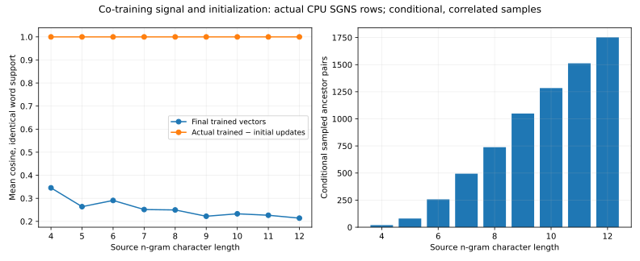
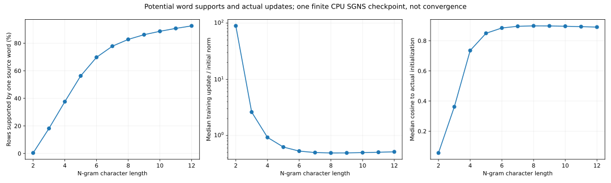
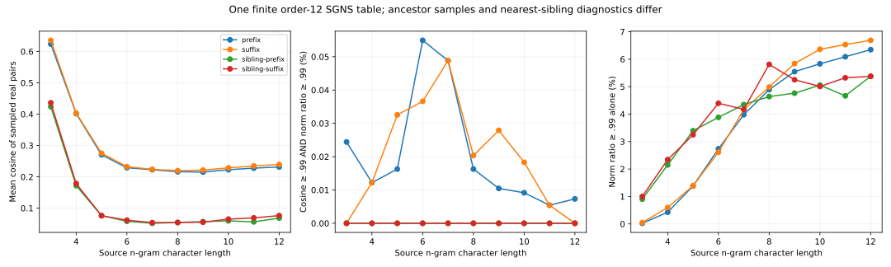
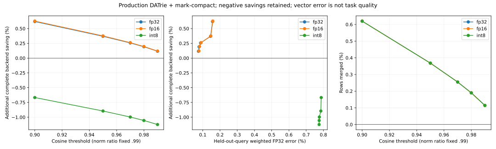

# Large-table structural applicability and the co-training signal

This study reuses **1,855,907 actually updated, distinct keyed n-gram rows ×
256 FP32 values**. It tests the production DATrie prefix/suffix planner and
mark-compact against matched storage controls, and diagnoses why structural
sharing is limited on this finite training reference. No vectors are fabricated,
tiled, retrained or taken from an official DeepSeek checkpoint.

The important distinction is measurable: in conditional pairs with identical
source-word support, **actual training updates point almost exactly in the same
direction**, while the final stored vectors retain substantial independent
initialization. Shared spelling or co-training therefore needs a direct vector
test before compaction. This is a property of this SGNS checkpoint, not a claim
about every fully trained n-gram model or LLM memory.

## Actual updates versus final vectors

The source is the [existing CPU capacity reference](../cpu_capacity_evidence_20261030/README.md):
cached enwik8, a raw chronological 90/10 split, lowercase ASCII words of length
2–64, minimum word count 2, and character n-grams of orders 2–12. Three finite
CPU SGNS epochs sample 1,212,126 adjacent pairs, using five negatives and seed
42. Rare-center coverage sampling overweights rare words; the reference retains
the averaged-forward/unaveraged-bag-gradient convention. It is not ordinary
full-corpus SGNS, convergence evidence or an LLM task-quality experiment.

The separately registered changed-row subset excludes 5,014 unchanged rows
(0.2694%) and preserves its original training-ID map. The actual initialization
file is checked by hash and read through that map. It is used only to diagnose
training, never to manufacture serving vectors or compression evidence.

Potential source-word supports are reconstructed from the exact training
vocabulary. They record word membership, not actual sampled SGD event counts
or multiplicities. For 256 uniformly sampled source IDs per character length,
registered proper prefix/suffix pairs with identical support have these results:

| Source length | Conditional sampled pairs | Mean final-vector cosine | Mean actual-update cosine |
| --- | ---: | ---: | ---: |
| 4 | 19 | 0.3454 | > 0.999999999999 |
| 8 | 738 | 0.2496 | > 0.999999999999 |
| 12 | 1,752 | 0.2140 | > 0.999999999999 |

Every conditional pair above passes 0.99 update cosine. These are correlated,
conditional samples, not independent replicates or a universal guarantee.
At length 12, 92.53% of rows have one potential source word; the median
`||trained − initial||₂ / ||initial||₂` is 0.513. Equal update direction alone
does not establish high cosine or matching magnitude of the final weights.




## Candidate applicability by length and relation

The primary vector audit samples 4,096 real source IDs without replacement per
character length and enumerates every registered proper prefix and suffix.
Each source-length/ancestor-length/direction stratum has at most one candidate
per source. Sources recur across strata, and pair averages are sampled-pair
averages. Length strata are slices of one order-12 model, not models separately
trained with different maximum orders. Word-boundary markers count as characters.

The paired control uses the same source and a real target of the same length
and boundary-marker class, excluding proper prefix/suffix relations. A separate
same-length sibling diagnostic uses nearest lexical/reversed-lexical neighbors
sharing at least two characters. That neighbor-biased sample is not a uniform
pair population or a candidate set accepted by the original ancestor planner.

Across 225,280 sampled pairs in each ancestor direction, about **99.65% of
prefix and 99.64% of suffix pairs admitted by norm ratio >= 0.99 alone fail
cosine >= 0.99**. Norm ratio and angle need separate guards. FP32's joint
thresholds 0.99/0.98/0.97/0.95/0.90, with norm ratio fixed at 0.99, merge
2,130/3,530/4,735/6,837/11,512 rows. The loosest setting merges only 0.62%.



## Complete storage and distortion controls

Every encoding uses the same frozen FP32 source. FP16 and symmetric per-row
INT8 are lossy; INT8 includes its four-byte FP32 scale inside each physical
encoded row. The original planner runs on decoded encoded rows, applies cosine
and norm-ratio guards directly to final representatives, and mark-compact packs
only surviving encoded rows. Native reconstruction is exact to those encoded
representative bytes, while joint sharing may change original vectors.

There are four controls per encoding: raw encoded mmap, native identity,
native lexical layout, and exact encoded-byte dedup. All original rows were
already lexically ordered; layout adds no table-byte gain. Exact byte dedup
finds no duplicates here. Small metadata-size differences remain in actual
complete totals. The structural denominator is the smallest same-encoding
control, including table, embedded forwarding/descriptors/scales, codec and
structural serving metadata, and **one common original keys JSON**.

| Encoding | Cosine/norm guards | Merged rows | Complete backend bytes | Extra saving vs best same-encoding control | Global FP32 relative error | Maximum row error |
| --- | --- | ---: | ---: | ---: | ---: | ---: |
| FP32 | 0.99/0.99 | 2,130 | 1,807,819,389 | +0.1164% | 0.5177% | 14.24% |
| FP32 | 0.90/0.99 | 11,512 | 1,798,720,182 | +0.6191% | 1.2523% | 44.91% |
| FP16 | 0.99/0.99 | 2,129 | 915,923,975 | +0.1197% | 0.5180% | 14.24% |
| FP16 | 0.90/0.99 | 11,506 | 911,272,814 | +0.6269% | 1.2523% | 44.91% |
| INT8 | 0.99/0.99 | 2,117 | 509,630,913 | -1.1240% | 0.9337% | 14.20% |
| INT8 | 0.90/0.99 | 11,498 | 507,328,228 | -0.6671% | 1.4617% | 44.96% |

At 0.90/0.99, FP32 and FP16 add only 0.62–0.63% savings on this table. INT8 remains 0.67% larger than raw INT8 even at that setting; at 0.99 it is 1.12% larger. Native identity already saves FP16 space independently of structural compaction. These negative INT8 results must not be counted as a structural gain.


An actual DATrie index is an independently measured alternative to that common
JSON. Its original key-to-ID lookup was reopened and checked for every key;
the three encoding runs produce identical serialized-index hashes. It does
not remove the original numeric ID space or prove a key-lookup speed advantage.

All 27 serving layouts reconstruct every original ID against the independent
codec/representative oracle in fresh verification workers. Total error against
original FP32, additional error against quantization-only rows, all-row and
merged-row tails, and per-length statistics remain separate. A 0.99 cosine
guard permits roughly 14% row-relative error; 0.90 permits roughly 45%.
Cosine percentage is not a vector-error percentage or a downstream loss budget.

The held-out query-weighted curves and 1,024 chronological word occurrences
also measure mean n-gram components with multiplicity. Missing registered grams
are omitted identically and counted in provenance. Original word/output rows
are unavailable in this export: these means are not complete FastText word
embeddings, logits, perplexity or model quality.



## Fresh numeric-query costs

Each encoding has two separately randomized process rounds per layout and
trace: 8,192 requests in 512-row batches, using held-out lexical IDs or uniform
IDs over the actual trained table. The latter randomizes access, not vectors.
First/second complete traces and a two-batch hot set are reported independently.
Native uses 8 KiB maximum decoded blocks and a 4 MiB decoded-row cache.

Median of two process p50 values, milliseconds per 512-row batch:

| Backend | First lexical trace | First uniform trace | Hot lexical set |
| --- | ---: | ---: | ---: |
| fp32-raw | 0.433 | 0.724 | 0.084 |
| fp32-joint-0.99 | 9.883 | 32.568 | 0.106 |
| fp16-raw | 0.652 | 1.054 | 0.406 |
| fp16-joint-0.99 | 9.663 | 35.011 | 0.433 |
| int8-raw | 0.342 | 0.812 | 0.160 |
| int8-joint-0.99 | 8.211 | 32.300 | 0.187 |

Joint native remains much slower on broad misses: roughly 31–45× raw on the first uniform trace. Hot timing hides that penalty. These traces show a storage/CPU tradeoff, not a numeric query speedup.


Both paths restore FP32 into the same preallocated output and encoded scratch.
These are the quantized-row APIs; the earlier capacity study's direct FP32
NumPy mmap control is separate. Numeric query workers avoid parsing unused
lexical keys and release the full offline representative map/source after
constructing their byte oracle. Output, scratch, oracle, runtime and file pages
still count toward process memory; cache size does not bound total RSS. Peak
RSS also includes oracle preparation. Builders parse the key registry and are
not minimal standalone streaming-export RSS controls.

The shared Ceph filesystem is warmed by construction and verification. First
trace means a fresh application cache, not disk-cold I/O. CPU exclusivity,
frequency and hard memory pressure are not controlled; process medians are
reported without a significance, whole-model speedup or GPU-throughput claim.

## Raw evidence and reproduction

The FP32 source SHA256 is
`0e5d4be0b156c5e9f0d745292876e48f78772c599d97902619123512955d82fc`.
The [complete report](report.json.gz), [readable summary](summary.json),
[pair audit](pair-audit.json.gz) and [actual update/support audit](training-support.json.gz)
retain source/library/index fingerprints, exact commands, Python/NumPy/Torch
installation versions, CPU/OS, thread settings, process resources and limitations.
Text, keys, weights and serving tables remain in the user's local research cache.

Primary FP32 plan/build/verify uses `2135a26`; independent FP16/INT8 runs use
`57b3663`; missing FP32 numeric queries and merge checks use `9553789`;
actual-update diagnosis uses `0170e78`. Full hashes and worker-level versions
are in the reports. Algorithm/codec/library inputs are unchanged across these
versions; query-harness memory correction is explicit.

FP16 and INT8 were split into independent single-thread CPU runs to avoid long
serial exports. The original controller was stopped after its completely
verified FP32 slice, avoiding duplicate remaining encodings. Its original
handoff report and status are preserved; a partial multi-encoding controller is
not reported as a completed full run. Combined reports require every prescribed
layout and complete verification before missing query workers run. The initial
query-replay waiter was superseded by this parallel orchestration.

With the existing training export and corpus available, a simpler sequential
reproduction from this checkout is:

```sh
export CUDA_VISIBLE_DEVICES=""
export OMP_NUM_THREADS=1 MKL_NUM_THREADS=1 OPENBLAS_NUM_THREADS=1
make native structural-native
nice -n 19 python -m tools.benchmark_large_structure run \
  --training-dir /path/to/training2 --corpus-zip /path/to/enwik8.zip \
  --output-dir /path/to/new-results \
  --native-library build/libmeft_rows.so \
  --structural-library build/libmeft_structural.so \
  --thresholds .99,.98,.97,.95,.90 --norm-ratio .99 \
  --trace-rows 8192 --batch-rows 512 --rounds 2 --repeat 10 \
  --sample-per-order 4096 --bag-count 1024 --seed 42
python -m tools.audit_training_support --training-dir /path/to/training2 \
  --corpus-zip /path/to/enwik8.zip --report /path/to/support.json
python -m tools.analyze_large_structure --report /path/to/new-results/report.json \
  --output-dir /path/to/analysis --plots --training-support /path/to/support.json
```

Linux x86-64, AMD EPYC 7742, Python 3.11.15, NumPy 2.2.6 and installed PyTorch
2.11.0; nice 19, one BLAS worker per process. This run does not train, download
data, import Torch in query workers, use a GPU or stop GPU programs. All remote
work stays under `/llm-align/duyimin/ngram-structure-20261031`. No paid API,
rented compute, energy measurement or monetary-cost estimate is added.

The first test launcher lacked pytest; its failure is retained and unittest
completed successfully. [Linux full-suite output](reproduction/full-tests-linux.txt)
records 145 tests with 17 skips at `57b3663`; [the local full-suite snapshot](local-tests.txt)
records 145 with 26 skips at `9553789`. [Current targeted checks](current-checks.json)
record 16 passing tests at `a79f2dd`; final PR CI remains a separate head check.
The [missing-pytest failure](reproduction/tests-missing-pytest.txt),
[initial CPU build](reproduction/build.txt), [parallel-run scripts](reproduction/run-fp16.sh),
[final query replay](reproduction/finalize.log) and [manifest](manifest.sha256)
make the exact evidence inspectable. Historical orchestration scripts and logs are evidence,
not portable commands to rerun against old paths/PIDs. Use the commands above.
The original FastText paper remains a separate arXiv preprint; this evidence
characterizes its software extensions and current applicability boundaries.
