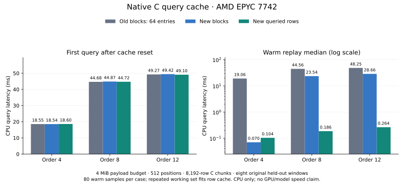

# Native query cache optimization — 2026-10-30

**Native C queries now use a lazy hash/LRU cache without the old 64-entry cap,
consume existing hits before misses can evict them, and optionally retain only
queried rows. Original artifacts, forwarding IDs, dtype and vector bytes are
unchanged.** Caching remains disabled at open; block caching remains the default
policy. Row caching is an explicit option for sparse repeated access.

On the original trained character-GRU tables and held-out query windows, a
4 MiB row-cache budget removes warm-replay decompression. These are **CPU reader
measurements**, not A100 gather latency or whole-model speedups. Eight fixed
chronological windows are replayed: their queried-row working sets fit this
budget. Fresh queries, larger working sets and cold starts do not receive the
same benefit. The new policy does not improve artifact compression.



EPYC CPU medians, 512 positions, 8,192-row C chunks, identical 4 MiB payload
budgets and query hashes:

| Max order | Old block cache ms | New block cache ms | New row cache ms | Old / row warm ratio |
| --- | ---: | ---: | ---: | ---: |
| 4 | 19.059 | 0.070 | 0.104 | 183.2× |
| 8 | 44.559 | 23.537 | 0.186 | 239.0× |
| 12 | 48.247 | 28.664 | 0.264 | 182.4× |

These large ratios require the replay working set to fit the row cache. The
first query after a cache reset remains about **18.5 / 44.7 / 49.1 ms** across
policies: first-miss decoding has not become hundreds of times faster. The
figure presents that first-query comparison alongside the warm replay.

## What changed and why

The measured artifacts have 64 rows/block, 64 float32 values/row, and 16 KiB
decoded blocks. Previously, the independent 64-entry limit retained only about
1 MiB despite a configured 4 MiB budget. Raising the budget alone consequently
left the high-order replay's decode counts unchanged.

The replacement hash index and linked LRU allocate metadata and entries only
when queried compressed blocks/rows are cached. No full-table index or decoded
table is allocated at open. Cached payload never exceeds its configured byte
budget, including during insertion; failed optional allocations fall back to
valid scratch output. Scratch, metadata, outputs and mapped pages are separate
memory costs. Hash growth temporarily retains the old and new bucket arrays.

Every ID and forwarding ID is validated before cache hits are served. Hits are
copied in original query order before miss insertion, so earlier misses cannot
evict a later needed hit. Only remaining misses are sorted and grouped by block;
fully cached calls skip sorting and decoding. Successful decodes alone can
publish cache entries. Raw blocks bypass persistent caching.

Row mode keys entries by **forwarded row ID**, allowing original aliases to
share one exact cache entry. It retains only requested rows from compressed
blocks. Misses still decode the complete block once per gather group; there is
no partial/unverified decode, approximate embedding or artifact rewrite.

## Evidence and limits

Tables and queries are the unchanged [trained preparation](../device_gather_preparation_20261030/README.md):
orders 4/8/12, seed 3; 11,760 / 36,778 / 43,152 rows × 64 float32 values. Every
native result is checked against its original trained-weight output digest.
Native workers never load `dense.pt`. No new training, random performance
vectors, row tiling or manufactured larger tables were used.

Each variant uses a separate process, preallocated CPU IDs/output, one Torch
thread/interop thread, an empty-cache chronological first pass, three subsequent
warmup passes and ten measured passes (80 timed queries/case). Profiles cover
1/32/128/512 positions, C gather chunks of 256/8,192 rows, and explicit budgets.
Counters aggregate individual C calls. First-pass samples and warm CPU/wall
samples are retained. Correctness hashing is outside timing; Python dispatch,
chunk iteration and counter collection are inside this CPU profiling interval.

Raw records:

- EPYC: [order 4](epyc-order-4.json), [order 8](epyc-order-8.json), [order 12](epyc-order-12.json).
- M5: [order 4](m5-order-4.json), [order 8](m5-order-8.json), [order 12](m5-order-12.json).
- [Inputs/source/library/build provenance](provenance.json), [Linux environment](remote-environment.json),
  [remote command script](run-remote.sh), [derived summary](summary.json) and
  [plot provenance](plot-provenance.json).
- [Local tests](local-tests.txt), [Linux CPU tests](remote-cpu-tests.txt),
  [local sanitizers](local-sanitizers.txt), [Linux sanitizers](remote-sanitizers.txt),
  [installed native wheel](wheel-check.txt).
- [Shared A100 correctness](cuda-correctness.json), [CUDA test details](cuda-tests.txt),
  [blocked CUDA performance probe](cuda-gather-blocked.json).

Local tests: 107 run, five hardware skips. Linux CPU: 107 run, seven hardware
skips. Selected A100 correctness: 20 run, 17 pass, three expected skips, including
new row-cache dtype/output ownership and tiny Qwen full/cached-logit fixtures.
Peak Torch allocation is 10,034,688 bytes under a 1% allocator cap; this test is
not the full original Qwen3-0.6B trained checkpoint run. ASan/UBSan cover both
cache policies, 300-block hash growth/eviction, and 128 mutated/truncated files.

### Choosing a policy

Across the eight longest windows, the original queried-row payload is about
0.892 / 1.789 / 1.965 MiB at orders 4/8/12. A 4 MiB row budget fits it; 1 MiB
does not fit orders 8/12. The latter retain substantial warm decode costs.
Whole-block caching can be faster when the entire decoded table fits: at order
4 the new block cache also removes warm decoding, has cheaper lookup, and warms
more quickly than row mode. Both policies are kept deliberately.

The byte budget covers cached **payload**, not equal total RSS across policies.
Rows require more metadata entries than blocks; `sizeof` of each current entry
is 48 bytes on these 64-bit targets, plus a power-of-two hash bucket array and
allocator overhead. Raw reports retain process RSS/peak and cached payload.
The old 64-entry cache did not necessarily use the whole configured budget.

These are warm filesystem, repeated-window microbenchmarks on shared hosts.
They do not measure cold disk I/O, concurrent serving, changing production
traffic, trained DeepSeek Engram, large-table scaling or end-to-end inference.
The older [A100 transfer/gather costs](../cuda_gather_evidence_20261030/README.md)
and [trained Qwen whole-model measurements](../qwen_cuda_performance_20261030/README.md)
remain separate. GPU7 was contended at 100% utilization; the performance gate
blocked the new CUDA run. Shared-device correctness is valid evidence for bits
and ownership, and supplies no trustworthy new accelerator latency.

## Usage and reproduction

Rebuild the native library or wheel. Existing block-only library loading remains
supported; requesting row mode on an older library raises a rebuild error and
closes the handle.

```python
from meft_memory import NativeRows, StagedMultiHeadEmbedding

with NativeRows("table.men", cache_bytes=4 * 1024**2, cache_policy="rows") as table:
    vectors = table.rows([0, 42, 0])
    print(table.cache_bytes, table.last_decompressions, table.last_row_cache_hits)

with StagedMultiHeadEmbedding(
    "exported-memory", device="cuda", native_cache_bytes=4 * 1024**2,
    native_cache_policy="rows", staging_rows=8192, staging_slots=2,
) as memory:
    vectors = memory(original_local_head_ids)
```

`MappedMultiHeadEmbedding`, `MappedEmbedding`, `MappedEmbeddingBag`,
`open_demo_embedding` and `load_tinyengram_checkpoint` also accept
`native_cache_policy="rows"`. C callers use
`meft_rows_set_cache_policy(store, 1)` plus `meft_rows_set_cache_bytes`.
Changing policy or budget clears entries. Block and distinct forwarded-row hit
counters remain separate; chunk/bag calls sum their individual gather counters.
Each handle remains immutable and single-worker.

Implementation commits: `1503514a38ad8a9458ab58bca7c4ab85efea1a4b`
(block cache/hit-first queries), `5276a7b` (row policy/adapters). Baseline:
`acda866d38772147ee4aaafaf5157ad77bb32218`. Input/library SHA-256, exact benchmark
commands, OS, CPU, Python and Torch are in the linked raw reports. Linux uses
GCC 11.4, Python 3.11.15/Torch 2.11.0+cu130 on EPYC 7742; macOS uses Apple clang
21, Python 3.12.14/Torch 2.14.1 on M5. Existing own-directory compute only;
no paid API, new data download or rented GPU. Energy/monetary cost is unmeasured.
Original corpus/weights remain local and are not redistributed.

```bash
git show acda866d38772147ee4aaafaf5157ad77bb32218:native/meft_rows.c > /tmp/meft-before.c
cc -std=c11 -O2 -Wall -Wextra -Werror -fPIC -shared -Inative \
  /tmp/meft-before.c -lz -o /tmp/meft-before.so
make native
python -m tools.benchmark_native_query \
  --fixture artifacts/device-gather-final-20261030/order-12-seed-3 \
  --library before=/tmp/meft-before.so --library blocks=build/libmeft_rows.so \
  --row-library rows=build/libmeft_rows.so --output-dir artifacts/native-query-reproduction \
  --cache-bytes 0,1048576,4194304 --chunk-rows 256,8192 --warmup 3 --repeat 10
python -m unittest discover -s tests
python tools/check_native_sanitizers.py
```

On macOS substitute `-dynamiclib`/`.dylib` and
`make native NATIVE_SHARED=-dynamiclib NATIVE_EXT=dylib`. Fixtures require the
original local trained checkpoint/corpus; the preparation tool verifies their
hashes and original test IDs before export.
