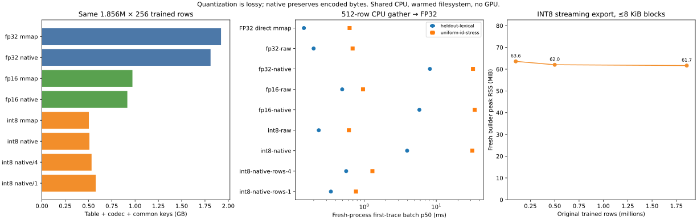

# Quantized capacity and CPU lookup on 1.85M trained n-gram rows

This extends the existing large-table reference with FP16/INT8, streaming
construction, smaller-block controls and repeated fresh-process CPU traces.
It reuses **1,855,907 × 256 genuinely updated FP32 rows**, or 475,112,192 scalar
values and 1,900,448,768 source bytes. No rows are synthesized or duplicated to
claim scale. The 100K/500K prefixes reuse actual rows and measure storage
construction scaling, not additional trained models.

The full CPU run passed **8 complete layouts, 2 trained-row prefix builds and 54 independent query workers**. FP16 native saves **52.29%** of complete backend bytes versus raw FP32, including common keys; **5.62%** is extra over raw FP16. Raw INT8 saves **73.78%**, but native INT8 expands the complete backend by **1.23%** versus raw INT8. These are different contributions: quantization savings must not be attributed to structural compression.

## Complete storage and construction

| Layout | Table + codec + keys bytes | Saving vs raw FP32 | Extra saving vs matched raw encoding | Builder peak RSS MiB |
| --- | ---: | ---: | ---: | ---: |
| fp32-raw | 1,921,879,166 | 0.00% | +0.00% | 59.3 |
| fp32-native | 1,809,925,278 | 5.83% | +5.83% | 86.1 |
| fp16-raw | 971,654,781 | 49.44% | +0.00% | 58.9 |
| fp16-native | 917,021,789 | 52.29% | +5.62% | 65.1 |
| int8-raw | 503,966,261 | 73.78% | +0.00% | 60.2 |
| int8-native | 510,146,194 | 73.46% | -1.23% | 61.7 |
| int8-native-rows-4 | 533,125,924 | 72.26% | -5.79% | 126.4 |
| int8-native-rows-1 | 578,203,012 | 69.91% | -14.73% | 379.7 |

The common key registry is **21,429,556 bytes**. The FP32 paths reconstruct all original bytes. FP16 has **0.0207%** global relative Frobenius error and **0.0263%** maximum per-row relative L2. INT8 has **0.779%** global and **1.160%** maximum per-row relative L2. Native variants add no further vector error in this identity-row study. No downstream loss, perplexity or model-output quality budget is measured.

INT8 1-row blocks are all raw fallback: map/descriptors add 40 bytes per original row. The complete bundle grows **14.73%** versus raw INT8, and builder RSS rises to 379.7 MiB. A raw block fallback alone therefore does not prevent whole-format expansion.

| Actual trained-row prefix | Source FP32 bytes | INT8 native table bytes | Builder peak RSS MiB |
| --- | ---: | ---: | ---: |
| 100,000 | 102,400,000 | 26,390,162 | 63.6 |
| 500,000 | 512,000,000 | 131,959,408 | 62.0 |
| 1,855,907 | 1,900,448,768 | 488,715,334 | 61.7 |

The observed 8 KiB INT8 builders remain around **62–64 MiB** across these prefixes. This is one fresh builder per size, not an asymptotic constant-memory claim: descriptor storage grows with block count. Source weights stay on disk, and temporary encoded/spool files remain outside serving bytes.

## CPU lookup and cache churn

| Layout | First lexical p50 ms | First uniform p50 ms | Second uniform p50 ms | Hot lexical p50 ms | RSS after first uniform MiB |
| --- | ---: | ---: | ---: | ---: | ---: |
| fp32-direct | 0.146 | 0.629 | 0.089 | 0.0383 | 280.1 |
| fp32-raw | 0.199 | 0.692 | 0.140 | 0.0814 | 280.7 |
| fp32-native | 8.165 | 32.279 | 30.820 | 0.1168 | 654.2 |
| fp16-raw | 0.496 | 0.964 | 0.476 | 0.4078 | 264.1 |
| fp16-native | 5.832 | 34.150 | 33.126 | 0.4415 | 536.0 |
| int8-raw | 0.235 | 0.615 | 0.183 | 0.1614 | 245.1 |
| int8-native | 3.946 | 31.550 | 30.702 | 0.1959 | 411.8 |
| int8-native-rows-4 | 0.564 | 1.302 | 0.367 | 0.2475 | 277.0 |
| int8-native-rows-1 | 0.346 | 0.770 | 0.361 | 0.2397 | 316.0 |

INT8 1-row layout lowers native first uniform p50 from **31.55 to 0.770 ms (41.0×)**. It remains slower and larger than **raw INT8 (0.615 ms)**. Native FP16 saves storage, but broad repeated access stays around **33 ms**, because a 4 MiB row cache does not retain the entire stress trace. Small hot-set timing alone conceals this cost.

Raw INT8 first uniform latency is near the direct FP32 mmap control on this shared host; these overlapping process ranges do not establish a speedup. Its hot lexical gather is **4.2× slower** than direct FP32, including CPU dequantization. The direct FP32 control also exposes wrapper overhead in the FP32 encoded reader.



## Matched builder improvement and measured raw fallback

The pre-streaming main at
[`1334883`](https://github.com/initial-d/ngram-store/commit/13348839cc414cceba4477af2e07b04da23374da)
exports the same complete INT8 native artifact in a fresh process using a
source FP32 mmap. Old and new **source, decoded and table hashes are identical**.
Peak process RSS drops from **9,118.0 MiB to 61.7 MiB (147.9× lower)**. Wall time
is 45.10 versus 43.68 seconds; this establishes a memory improvement, not a
significant CPU speedup. Old RSS includes mapped source pages and full
conversion/hash arrays; the file path avoids source mmap residency and those
whole-table temporaries. Builder order is fixed on the same shared host, with
no cgroup limit or OOM test.

The optional `native="auto"` policy is verified afterward at
[`9485969`](https://github.com/initial-d/ngram-store/commit/9485969066ee4be466673cde07823330da1a7658).
It compares actual table plus codec JSON bytes for identity rows; common keys
cancel. On this full INT8 source it discards the expanded native candidate and
publishes **raw_mmap**, preserving the verified raw control's source, decoded
and table hashes. All **1,855,907** auto rows also pass a fresh reader check.
Auto construction peaks at **62.2 MiB**, takes 44.33 seconds and still constructs
the native candidate before choosing. It selects for size, not latency, and
rejects structural forwarding/reordering/dedup. Explicit raw/native choices
remain available and unchanged.

The auto bundle is **482,536,985 bytes without common keys**, or 503,966,541 bytes
with them. Its policy audit adds 280 metadata bytes versus the explicit raw
control; that small cost is retained. Native and raw candidate codec metadata
are included in selection, rather than trusting per-block fallback alone.
See [old-build.json](old-build.json), [auto-build.json](auto-build.json),
[auto-verify.json](auto-verify.json), [old-build.py](old-build.py),
[auto-build.py](auto-build.py), [old-run.sh](old-run.sh) and
[supplement-run.sh](supplement-run.sh). These are separate source-pinned runs
performed after all main query workers finished. The main report's timings
remain at the original frozen runtime; the later runner also corrects only the
direct-buffer reporting field outside the timed gather loop.

Linux's earlier full suite reports 140 tests with 17 dependency/platform skips
in [tests.txt](tests.txt). The later auto/codec/capacity suite passes all 12 tests
in [auto-tests.log](auto-tests.log); local final suite passes 141 tests with 26
skips. The full-suite SSH launcher timed out at 60 seconds while remote tests
completed in 66.453 seconds; [checks-ssh-timeout.txt](checks-ssh-timeout.txt)
preserves this launcher failure separately from passed experiment workers.


## What these measurements cover

Quantization is approximate to FP32. INT8 stores a FP32 scale in each row,
alongside 256 signed codes; FP16 stores rounded values. Native compression
preserves these encoded bytes and original IDs. Every full-table variant is
checked against a separately computed codec oracle for **all original IDs**,
including the preallocated FP32 decode path. Source, decoded and artifact
hashes are retained. Vector error does not establish downstream task quality.

These variants use identity row order without deduplication or structural
sharing. Savings over raw FP16/INT8 therefore measure the ordinary block codec
after quantization, **not a DATrie/mark-compact gain**. The original algorithm's
contribution is measured separately in [trained structural controls](../structural_native_evidence_20261030/README.md),
[small quantized references](../quantized_structural_evidence_20261031/README.md)
and the [large FP32 table](../cpu_capacity_evidence_20261030/README.md).
The latter has only 0.12% extra joint row savings, which remains a useful
boundary rather than being replaced by the quantization result here.

The complete backend count includes table/map/descriptors/scales, codec JSON
and the same actual key registry JSON. Keys are counted for every full-table
variant, even models that already have numeric row IDs. No backbone/model
checkpoint, runtime/framework, training provenance map or temporary build
files are counted as serving bytes. Staging/spool/publication files need extra
disk space; peak temporary disk usage is not measured. Structural planning
still holds full vectors/maps offline.

## Trained-row provenance

The cached enwik8 raw bytes are split 90/10 before preprocessing. The training
registry uses lowercase ASCII words of length 2–64, min-count 2 and n-gram
orders 2–12. The original CPU SGNS reference has dimension 256, five negatives,
seed 42, four threads, three finite epochs and 1,212,126 sampled adjacent pairs.
Rare-center coverage sampling overweights rare centers; this is neither
ordinary full-corpus SGNS nor evidence of convergence or model quality.

The initial export rejected 5,014 unchanged rows. The registered changed-row
subset explicitly excludes 0.2694% and retains the original training-ID map.
Every exported row is finite and changed. This study uses that exact subset;
it does not delete rows from a full-model converter. Original training and
exclusion details remain in the [capacity provenance](../cpu_capacity_evidence_20261030/README.md).

## Protocol and reproducibility

Each constructor, verifier and query trace runs in a separate process. Full
table codecs use at most 8,192 decoded bytes/block: 8 FP32, 16 FP16 or 31 INT8
rows at dimension 256. Additional INT8 1/4-row layouts trade descriptor cost for
sparse decoding. All exporters use 4,096-row codec/hash chunks and identity
forwarding. Native descriptors still grow with block count, so this is a
bounded codec working set rather than a constant-RSS guarantee.

The held-out lexical and uniform-ID stress traces are unchanged from the
capacity reference: 65,536 requests each in 512-row batches. Uniform access is
synthetic **access on real vectors**, not synthetic-vector compression evidence.
Each worker measures the first complete trace, a second complete replay, and
20 repetitions of the first eight batches after warmup. This separates broad
cache churn from the small hot subset. Native row-cache payload is 4 MiB;
mapped file pages, output, cache indexes and runtime metadata are extra.

Three rounds independently shuffle all variant/trace jobs with seeds 42–44.
Tables report the median of per-process p50 values; p95/p99, throughput and
per-process ranges are in [summary.json](summary.json). Ranges across three
processes are not confidence intervals. Both encoded backends use the same
preallocated encoded scratch and FP32 output. The direct FP32 mmap control
uses NumPy `take(out=..., mode="clip")` into FP32 without dequantization or
the codec wrapper. Query hashes and codec-counter collection occur outside
the measured gather interval. Counters measure logical compressed/decompressed
codec bytes, excluding raw-row copies and cache hits; they are not disk I/O.
The frozen direct worker's buffer field counts only its active 512 KiB output;
it also allocates an unused 512 KiB scratch. The summary counts both, and RSS
already includes all resident allocations. The current runner corrects that
reporting field without changing the measured gather loop.

The shared Linux AMD EPYC 7742 host runs Python 3.11.15, NumPy 2.2.6 and has
PyTorch 2.11.0 installed (unused by the experiment). CPU workers use nice
19 and one OMP/MKL/OpenBLAS thread. No GPU programs are queried or modified,
weights retrained, or external data downloaded. Verification and construction
warm filesystem pages: first trace means a fresh process and empty application
cache, **not disk-cold access**. CPU frequency/exclusivity, memory-pressure
behavior and whole-model inference are outside the study.

The frozen runtime source is
[`20d111c`](https://github.com/initial-d/ngram-store/commit/20d111c0830239b7b19ba787479a00fdffb90b07).
[run.sh](run.sh) contains the exact command; [setup.sh](setup.sh) preserves
compiler flags, and [compiler.txt](compiler.txt), [tests.txt](tests.txt),
[run.log](run.log) and [report.json.gz](report.json.gz) preserve environment,
raw samples/counters, commands, source/library/table hashes and outcomes.
Raw text, keys, weights and serving tables stay on the user's machine.

With the cached trained source available, build the native library from the
pinned commit and run `run.sh`. Analyze the exported report locally:

```bash
python -m tools.analyze_quantized_capacity \
  --report docs/quantized_capacity_evidence_20261031/report.json.gz \
  --output-dir artifacts/quantized-capacity-analysis --plots
```

These are storage/CPU results from one English sparse-training reference.
They do not establish a large-model memory-quality budget, original learned
Engram checkpoint compatibility, production latency or a universal win over
raw mmap/other compression engines.
