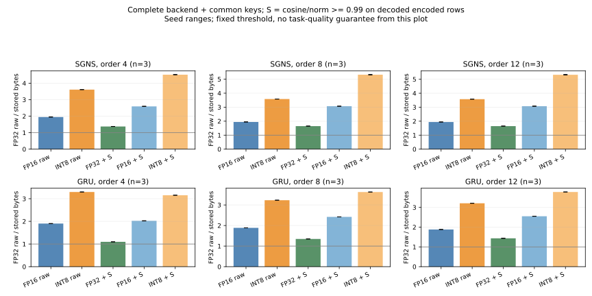
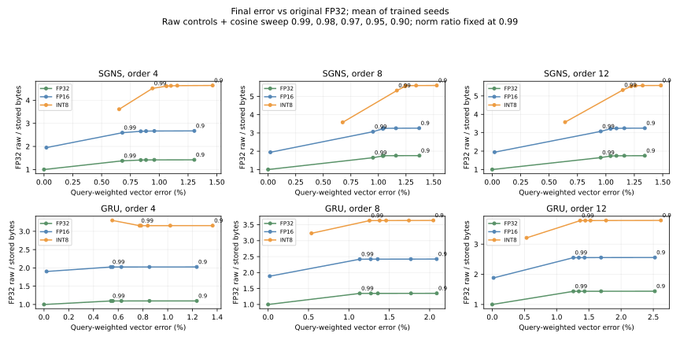

# Quantization and original structural sharing on the same trained tables

The original DATrie prefix/suffix planner and mark-compact retain an additional
storage contribution after FP16 and per-row INT8 on these trained references.
It is workload-dependent: INT8 compaction makes the 4-order GRU backend larger.
Quantization and joint sharing are **approximate to original FP32 weights**;
native packing preserves their encoded representative bytes and original IDs.

## Matched storage results

Three-seed **means**, fixed cosine and norm ratio 0.99 on decoded encoded rows.
The denominator is the smallest same-encoding control among raw mmap, native
identity, native lexical layout and exact encoded-byte dedup. Actual totals
include the row table, forwarding map, codec metadata, INT8 scales and a common
keys JSON. Positive values are extra space saved; negative values are regressions.

| Reference / max order | Additional FP16 saving | Additional INT8 saving |
| --- | ---: | ---: |
| SGNS / 4 | +22.94% | +20.03% |
| SGNS / 8 | +33.22% | +28.30% |
| SGNS / 12 | +33.11% | +28.08% |
| GRU / 4 | +5.26% | -4.56% |
| GRU / 8 | +21.13% | +10.95% |
| GRU / 12 | +25.42% | +15.10% |

SGNS reports vector distortion, without a downstream task claim. The causal
GRU has held-out character prediction metrics. The DATrie alternative replaces
common keys JSON with an actual serialized exact-key index; its matched totals
are also in [report.json](report.json) and [summary.json](summary.json). For INT8,
those extra savings average 20.78/29.83/29.68% on SGNS and −4.90/12.14/16.90% on
GRU at orders 4/8/12. Index lookup speed is outside this study.



## Quality and selection boundaries

The primary study selects the smallest backend within all validation budgets,
separately by encoding: relative perplexity increase <= 0.5%, mean prediction
KL <= 0.0001 nats, and top-1 changes <= 1% of positions. All choices are frozen
before testing selected candidates; fixed raw FP16/INT8 test controls remain
separate. Paired character-block intervals are reported without reselection.

**20/27 primary validation choices pass all test budgets; seven fail mean KL.**
The selected INT8 paths pass 8/9: all 4-order runs select raw INT8; 8-order seed 3
fails KL; all three 12-order selections pass. The latter save an additional
15.17–15.25% backend bytes over the best INT8 control, or 12.38–12.44% of the
measured whole serving bundle. Their test perplexity increases 0.0051–0.0208%.
These selected looser thresholds have maximum per-row relative L2 error of
31–44%; small task changes do not establish small weight errors.

The fixed default 0.99 bundles receive a **separate post-main-run test audit**
in [fixed099-test-audit.json](fixed099-test-audit.json): **27/27 pass** the same
budgets, with test perplexity changes -0.0050% to +0.0172% and maximum mean KL
1.62e-05 nats. It does not replace any
primary choices or failures and is not preregistered confirmatory evidence.
Fixed thresholds were present in the original storage/validation sweep. Future
quality confirmation needs independent data/checkpoints.

The fixed 0.99 sweep reaches **14.31% maximum per-row relative L2 error** against
original FP32, including INT8 rounding. “99% cosine” is not “1% vector error.”
The query-weighted Frobenius curve below includes quantization's own error;
additional error versus quantization-only is recorded separately. Relaxing the
cosine guard on GRU adds little capacity benefit while increasing error tails.



Warm CPU gather p50 is **1.04–1.21× raw encoded mmap** for the fixed joint paths,
including Python/NumPy dequantization. This study supports extra storage savings,
with a query cost; it does not show a numeric gather speedup. First query means
empty application cache on warmed filesystem pages, not disk-cold I/O.

## Reproduce and inspect

The primary run used clean source commit
[`3a54de2`](https://github.com/initial-d/ngram-store/commit/3a54de2d8a7b97ee1432980c41b4edb0f64566d3),
Python 3.11.15, PyTorch 2.11.0+cu130, NumPy 2.2.6, Linux x86-64 and an AMD EPYC
7742 shared host. One PyTorch/interop/BLAS worker at nice 19, **CPU only**;
wall time 8m48s. No weights were trained, external text downloaded or GPU
programs touched. The corpus/checkpoint/row/source/library hashes and exact
command are in the raw report. Build flags, tests and timing are retained in
[build.txt](build.txt), [tests.txt](tests.txt), [run.sh](run.sh), [run.log](run.log)
and [environment-extra.json](environment-extra.json). An initial launcher failed
because `/usr/bin/time` was unavailable; [its error](resources-launch-failure.txt)
is retained. Bash timing was used for the successful run.

This is **18 cached public-text trained models and 486 storage variants**:
SGNS/GRU orders 4/8/12, seeds 3/7/11; FP32/FP16/INT8, four encoded controls and
five joint cosine thresholds (0.99/0.98/0.97/0.95/0.90), norm ratio fixed at 0.99.
The production Linux DATrie planner is used; the portable reference planner is a
separate smoke-test path. Every encoded row and original-ID forwarding result
was checked. Planning uses rounded/dequantized rows before physical compaction.
INT8 is symmetric nearest-even [-127,127], with its float32 scale inside the row.

With the original cached inputs available, build and run the command from
`run.sh` inside the pinned checkout. Summarize from the current repository:

```bash
python -m tools.analyze_quantized_structural \
  --report docs/quantized_structural_evidence_20261031/report.json \
  --output-dir artifacts/quantized-analysis --plots
```

A later finite-range INT8 guard prevents decode overflow near max float32.
[codec-revision-check.json](codec-revision-check.json) verifies identical encoded
and decoded bytes for all **54 trained encoding inputs**, using
[verify_codec_revision.py](verify_codec_revision.py). Primary timings remain
at the pinned study source. [audit_fixed099.py](audit_fixed099.py) reproduces the
separate default-threshold audit in the pinned remote checkout.

The measured whole GRU bundle sums backend/codec, common keys JSON and an actual
serialized unchanged backbone/registry; the separate keys JSON duplicates key
information held inside that registry, so it is a conservative evaluation
bundle, not a minimal facade. Runtime/framework, training checkpoint, logs and
builder/RSS costs are excluded. CPU exclusivity and frequency were not pinned.
These small English SGNS/GRU references are not an official trained DeepSeek
Engram checkpoint, a paper-scale reproduction, all-language evidence or a
comparison with every learned/vector quantizer. Raw text, keys, weights and
serving bundles remain local.
