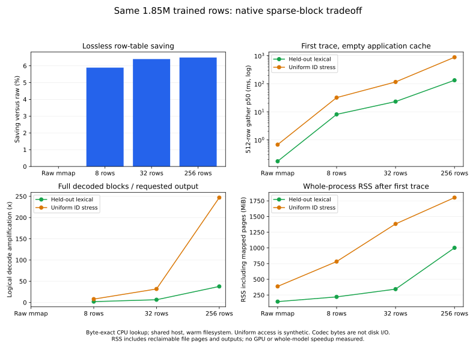

# Smaller lossless native blocks on the same 1.85M trained rows

This CPU experiment addresses the sparse-miss bottleneck exposed by the
[capacity controls](../cpu_capacity_evidence_20261030/README.md). It repacks the
**same unchanged 1,855,907 × 256 float32 trained rows**, retains all original
storage IDs, verifies the full reconstructed SHA256, and replays the identical
held-out lexical and uniform-ID query oracles. No new training or random
embedding table is substituted. Uniform ID access is a synthetic access pattern
on genuine trained rows, not a model workload.

**Eight-row blocks reduce first lexical p50 from 132.70 to 8.07 ms (16.4×)
and uniform-stress p50 from 876.08 to 31.94 ms (27.4×), versus a freshly
remeasured 256-row native baseline.** The table grows by 11,508,692 bytes
(10.98 MiB, 0.65% versus the existing native file); lossless saving versus raw
remains 5.89%. Raw mmap remains substantially faster and touches fewer pages
on these traces. This establishes a native-layout improvement, not a native
speed/capacity advantage over raw mmap or a whole-model speedup.

## Measured tradeoff

| Backend/layout | Row-table bytes | Saving vs raw | First lexical p50 ms | First uniform p50 ms | Hot lexical p50 ms |
| --- | ---: | ---: | ---: | ---: | ---: |
| Raw mmap | 1,900,448,768 | — | 0.172 | 0.674 | 0.0379 |
| Native 8 rows | 1,788,494,457 | 5.89% | 8.074 | 31.944 | 0.0610 |
| Native 32 rows | 1,778,755,690 | 6.40% | 23.072 | 115.458 | 0.0624 |
| Native 256 rows | 1,776,985,765 | 6.50% | 132.702 | 876.084 | 0.0677 |

| Layout | Lexical decoded/output ratio | Uniform decoded/output ratio | Lexical RSS MiB | Lexical anonymous MiB | Uniform RSS MiB |
| --- | ---: | ---: | ---: | ---: | ---: |
| Raw mmap | No codec | No codec | 145.1 | 85.9 | 387.4 |
| Native 8 rows | 2.07× | 7.99× | 220.4 | 90.2 | 783.3 |
| Native 32 rows | 6.51× | 31.86× | 344.0 | 90.3 | 1,382.6 |
| Native 256 rows | 37.81× | 247.10× | 1,002.0 | 90.5 | 1,801.9 |

Memory is recorded after the first trace in each worker. Uniform replay follows
lexical replay in the same worker, so its RSS is cumulative across both traces;
the application row cache is cleared between them. Codec/output ratios sum
logical decoded bytes across the trace and divide by requested output bytes,
including repeated output IDs. They are neither per-query medians nor disk-read
amplification. Hot medians remain around 0.06–0.07 ms across native layouts;
the major improvement is misses, not the already cached path.



## Usable change

Native export now accepts `max_block_bytes` to bound decoded block size rather
than assume one row count suits every embedding dimension:

```python
from meft_memory import export_embedding

export_embedding(frozen_memory, "memory-sparse", backend="native",
                 deduplicate=False, predictor="xor", max_block_bytes=8192)
```

For 256-dimensional float32 rows, 8192 bytes selects eight rows instead of the
existing 256-row default. Effective rows are
`min(block_rows, max(1, max_block_bytes // row_bytes))`; at least one indivisible
row is kept, even if it exceeds the target. The option also works in multi-head,
EmbeddingBag, DATrie/mark-compact `StructuralPlan.export` and full frozen
TinyEngram checkpoint export (`meft-tiny-export --max-block-bytes 8192`).
It controls block layout and staging, **not process RSS**. Defaults and existing
file formats/readers remain compatible. Changing block size is a serving-layout
optimization separate from the paper's DATrie indexing and structural sharing.

The C ABI additionally exposes `meft_rows_last_compressed_bytes` and
`meft_rows_last_decoded_bytes`; Python uses `last_compressed_bytes` and
`last_decoded_bytes`. These count codec input and full decompressed block output
for successfully decoded blocks, including repeated decoding across chunks/bags.
Raw-row copies and cache hits contribute zero. They measure logical codec work,
**not disk I/O, page faults, or file residency**. Older compiled libraries still
serve rows; these new counters require the updated library.

## Protocol and boundaries

Raw rows occupy 1,900,448,768 bytes. Source and all three reconstructed hashes:
`0e5d4be0b156c5e9f0d745292876e48f78772c599d97902619123512955d82fc`.
The source is the finite enwik8 SGNS reference with explicitly excluded untrained
rows; coverage sampling overweights rare centers and convergence/task quality
are unmeasured. [Training provenance](../cpu_capacity_evidence_20261030/training.json)
and rejected-run evidence remain unchanged.

Fresh workers use direct C `gather_into` or NumPy
`take(out=preallocated, mode="clip")`, a 4 MiB decoded **row** cache, and the
original 65,536-row traces in 512-row queries. Hot results repeat the first eight
queries 20 times. All queries are checked against existing per-query SHA256
oracles. Verification/packing happens outside timed worker processes and warms
the shared Ceph filesystem/page cache. First replay starts with an empty
application cache; it is not disk-cold latency. Fixed worker order, one shared
host run, and no significance or production-performance claim.

RSS includes reclaimable mapped pages, output buffers (~64 MiB per trace),
scratch and Python runtime; anonymous memory is reported separately. Smaller
blocks can still touch more pages than raw mmap. Memory cgroups are read-only:
no enforced cap, reclaim-pressure, OOM, GPU throughput or model task-quality
result is claimed. Existing shared CPU only; no purchased compute/API costs
or monetary/energy measurements. GPU programs were untouched.

## Reproduction and evidence

Benchmark/native runtime source:
`4598b7a151afa356422b78fe666bdbf7c67c906d`.
Adapter/structural/checkpoint interface validation source:
`8c56ef6116b7b1584d429ab64c8887e020359208`.
The original 256-row artifact is reused from the capacity study, then fully
verified and measured again with the same new reader as the other layouts.
The 8/32-row artifacts are newly packed with exact deduplication disabled.

```sh
export CUDA_VISIBLE_DEVICES=""
export OMP_NUM_THREADS=1 OPENBLAS_NUM_THREADS=1 MKL_NUM_THREADS=1
make native
nice -n 10 python -m tools.benchmark_sparse_blocks \
  --training-dir /path/to/existing-training \
  --query-manifest /path/to/capacity/queries-ordinary.json \
  --output-dir /path/to/new-sparse-evidence \
  --native-library build/libmeft_rows.so \
  --block-rows 8 32 256 --repeat 20 \
  --reuse-baseline /path/to/capacity/native-ordinary.men
python -m tools.plot_sparse_blocks --report /path/to/new-sparse-evidence/report.json \
  --output-dir /path/to/plots
```

[Exact run script](run.sh) records the actual paths and module invocation.
The initial `environment.command` strings in the raw report omit `-m` because
that source reconstructed commands from `sys.argv`; use the run script and
per-worker command arrays for reproduction. The final implementation records
`sys.orig_argv` instead. [Raw report](report.json) contains sample timings,
per-query codec counters, environment, training provenance and artifact hashes;
[summary](summary.json) is calculated from that report, not another run.
The query manifest is reused byte-for-byte and its hash is recorded.

Linux 5.4.0-42 x86-64, AMD EPYC 7742, Python 3.11.15, NumPy 2.2.6;
CPU training provenance uses Torch 2.11.0+cu130, but timed workers import no
Torch and CUDA visibility is empty. All remote work stays under
`/llm-align/duyimin/meft-cpu-capacity-20261030`.

[Build](build.txt), [benchmark log](run.log), [Linux native/structural tests](remote-tests.txt),
[Linux checkpoint tests](remote-checkpoint-tests.txt),
[local full suite](local-full-tests.txt), [targeted tests](local-targeted-tests.txt),
[EmbeddingBag tests](bag-tests.txt) and [ASan/UBSan](sanitizers.txt) are software
validation, separate from trained-table serving measurements. Full/cached Qwen
logit equality uses a tiny trained interface fixture, not a quality or speedup
study of a pretrained large model. Linux DATrie checks use the actual bundled
trie library; the corresponding platform-specific macOS cases skip.
