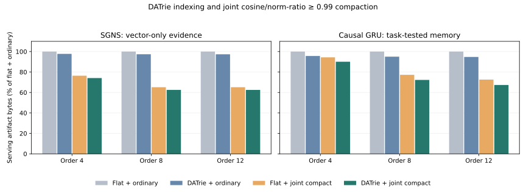
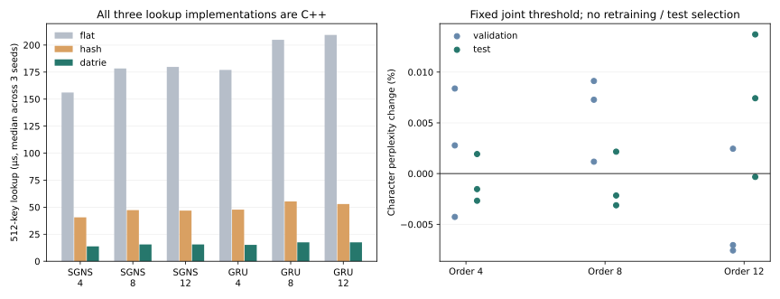

# Original DATrie and mark-compact in the native memory backend

The native backend now reuses the production DATrie prefix/suffix callbacks in
[`src/legacy_merge.h`](../../src/legacy_merge.h), then marks surviving original
rows and compacts them directly into compressed native blocks. It keeps the
original numeric ID space and dense forwarding map. The earlier native cache
optimization is an independent contribution; it did not implement this planner.

The optional C ABI is [`native/meft_structural.h`](../../native/meft_structural.h).
[`StructuralPlan`](../../tools/structural_native.py) exposes it to Python and
exports artifacts accepted by the existing frozen `MappedEmbedding` adapter.
The bundled DATrie/DASTrie archives support Linux x86-64. Standard native row
storage and wheels retain their separate Linux/macOS support.

| Mode | Representative selection | Original vector bytes |
| --- | --- | --- |
| `layout` | Keep every row; keyed rows in lexical trie order | Preserved |
| `exact` | Original prefix/suffix traversal with byte comparison | Preserved, including signed zero and NaN payloads |
| `joint` | Prefix/suffix relation, cosine and min(norm)/max(norm) thresholds | May change; explicitly marked approximate |

Each original row is checked directly against its final representative. The
planner resolves representatives to roots and rejects non-idempotent plans;
native packing reads only marked survivors and rewrites original IDs to dense
physical rows. It does not construct an expanded approximate table and then
rename generic deduplication as mark-compact. `deduplicate=False` separates this
selection from the existing byte-dedup mechanism in these experiments.

The key index returns **original IDs**, including keys whose physical row was
merged. A caller that already has numeric/hash IDs can query `table.men` without
the key index. Trie lookup requires a known, unique key-to-row registry; a
hashed Engram bucket with multiple colliding n-grams is not certified by this
API. These results do not replace Engram hashing or establish trained DeepSeek
Engram equivalence. DASTrie files use trusted legacy serialization and are not
an untrusted-input or architecture-neutral format.

## Trained evidence

18 runs cover orders 4/8/12 and seeds 3/7/11 for **each** training reference.
The following are three-seed medians; raw seed ranges remain in the summary.

| Reference / order | Extra row-table saving from joint compaction | Total saving vs flat + ordinary | Lossless key-index saving | Key lookup speed vs C++ hash |
| --- | ---: | ---: | ---: | ---: |
| SGNS / 4 | 24.6% | 25.9% | 58.6% | 2.92× |
| SGNS / 8 | 36.4% | 37.5% | 61.5% | 3.04× |
| SGNS / 12 | 36.4% | 37.5% | 62.1% | 3.01× |
| GRU / 4 | 6.1% | 9.9% | 58.6% | 3.12× |
| GRU / 8 | 24.7% | 27.7% | 62.4% | 3.16× |
| GRU / 12 | 29.9% | 32.7% | 63.6% | 2.97× |

The row-table and total savings above use **approximate** joint sharing.
Layout/exact modes preserve every original byte and GRU logit, but found **zero**
byte-identical structural rows to merge in all 18 trained tables. The lossless
contribution here is the compact exact key index, not extra row sharing. DATrie
is about 3× faster than `std::unordered_map` for these 512-key traces; it does
not accelerate a model that already supplies numeric IDs merely by existing.

GRU validation/test character-perplexity changes under joint sharing range from
**−0.0076% to +0.0137%** over the nine checkpoints; the largest top-1 change is
**0.1534% of positions**. These are descriptive results at a fixed threshold,
not a quality guarantee or a confidence interval. Both validation and test are
reported; there is no test-based selection.

Maximum per-row relative L2 error reaches **14.24%** despite the 0.99 joint
criterion. The small observed GRU task changes do not turn approximate weight
sharing into lossless compression. Full vector fidelity remains in each run.

Repeated working sets already fit the 4 MiB row cache. Warm numeric gathers
remain about **0.021–0.029 ms**, with no consistent extra compaction speedup.
Thus the additional contributions measured here are storage and exact key
lookup. Generic cache acceleration retains its separate evidence.

Higher order strengthens compaction from 4 to 8 in both references. SGNS
largely plateaus from 8 to 12, while GRU continues to improve. This supports a
training- and distribution-dependent effect, not a universal monotonic rule.





The four storage configurations use the same native codec, 256-row blocks,
original query traces and row/block cache budgets: flat keys + ordinary table,
DATrie + ordinary table, flat keys + joint compact table, DATrie + joint compact
table. The flat/compact configuration still uses DATrie at build time; it
isolates the **serving index**, not a trie-free builder. The two serialized
indices encode the same original IDs. Hash lookup has a separate C++
`std::unordered_map` control, without an estimated hash storage/RSS number.

All vectors come from existing training runs on cached TinyShakespeare text.
SGNS is a FastText-style training reference with shared bag gradients; the GRU
has an exact character-suffix memory with averaged gradients and actual
validation/test prediction metrics. Neither is the paper's large-corpus
experiment or a trained DeepSeek Engram checkpoint. No random vectors are used
for compression/performance evidence, no new model is trained, and no threshold
is selected on test. Joint cosine/norm-ratio 0.99 is fixed for this ablation.

Artifact totals count the serving key index, original-ID forwarding and encoded
row table; they exclude JSON reports, backbone, character vocabulary and runtime
objects. Index lookup is single-worker CPU timing through the same ctypes batch
boundary, with queries/output preallocated. The filesystem is warm after export
and verification; a first query starts with an empty application cache and is
not disk-cold latency. Warm queries repeat one working set. No production,
continuous-traffic, whole-model latency, GPU or peak-RSS gain is claimed.

## Use the actual adapter

On Linux x86-64, build the optional bridge from this source checkout:

```bash
make native structural-native
python -m pip install -e '.[torch]'
```

```python
from meft_memory import StructuralPlan, MappedEmbedding

# Existing immutable float32 rows and real UTF-8 keys; IDs are the model's IDs.
# Omit special/padding rows from keys: they remain identity-mapped.
with StructuralPlan(source.read_bytes(), dim, keys_by_original_id,
                    "build/libmeft_structural.so", mode="exact") as plan:
    plan.export(source, output_dir, block_rows=256)

model.memory = MappedEmbedding(output_dir, "build/libmeft_rows.so",
                               native_cache_bytes=4 * 1024 * 1024,
                               native_cache_policy="rows")
# Use inference only; callers must manage memory.close(). No tied .weight API.
```

`mode="joint", cosine=.99, norm_ratio=.99` opts into changed weights. The
export records original/reconstructed hashes, thresholds and byte preservation
in `structural.json` and `embedding.json`. A cosine of 0.99 alone is not a
downstream loss bound; vector error and task quality must be checked separately.

## Reproduce and inspect

Raw reports: [memory ablation](memory-report.json),
[three C++ lookup controls](lookup-report.json),
[artifact manifest](artifact-manifest.json), and [summary](summary.json).
The reports contain commit/source/library hashes, exact commands, environment,
training/corpus/query provenance, cache counters and individual timing samples.
Storage was measured at `3b82ab0`; adapter integration at `4df6b7e`; the hash
control at `e23315b`. The later commits retain the same merge/compaction logic.
The SSH wait timed out while the CPU worker continued; all completed runs are
preserved and completion is verified separately in the artifact manifest.

With the cached corpus and the previously generated training artifacts:

```bash
python -m tools.benchmark_structural_native \
  --sgns-dir artifacts/native-ngram-20261018/trained-reference \
  --gru-dir artifacts/causal-lm-compression-20261024 \
  --corpus artifacts/native-ngram-20261018/corpus/tinyshakespeare.txt \
  --native-library build/libmeft_rows.so \
  --structural-library build/libmeft_structural.so \
  --output-dir artifacts/structural-native-20261030 \
  --orders 4,8,12 --seeds 3,7,11 --block-rows 256 \
  --cache-bytes 4194304 --query-rows 512 --repeat 40

python -m tools.benchmark_structural_lookup \
  --memory-report artifacts/structural-native-20261030/report.json \
  --sgns-dir artifacts/native-ngram-20261018/trained-reference \
  --gru-dir artifacts/causal-lm-compression-20261024 \
  --corpus artifacts/native-ngram-20261018/corpus/tinyshakespeare.txt \
  --structural-library build/libmeft_structural.so \
  --output artifacts/structural-native-20261030/lookup-report.json --repeat 120

python -m tools.analyze_structural_native \
  --memory-report artifacts/structural-native-20261030/report.json \
  --lookup-report artifacts/structural-native-20261030/lookup-report.json \
  --output-dir artifacts/structural-native-20261030/figures
```

The original trained-reference commands and provenance are documented in
[SGNS evidence](../trained_ngram_similarity_20261018.md) and
[causal LM evidence](../causal_lm_evidence_20261024/README.md). Corpus, keys and
weights stay local; the corpus license has not been independently established.

Real bundled-library regression tests cover UTF-8/newlines, original IDs,
signed-zero byte distinction, final representative drift, direction/norm
rejection, failure cleanup, serialized DASTrie lookup, both native caches and
the existing frozen PyTorch adapter. ASan/UBSan check the bridge; bundled archives
themselves are not sanitizer-instrumented. The full legacy exporter roundtrip
remains in CI, so the historical 0.99 default is independently checked.

This is an executable extension of DATrie-driven selection and dense compaction
to indexed learned memory, plus new trained-reference evidence. It supports
describing those specific contributions in the paper; it does not reproduce or
strengthen the original paper's large-corpus headline numbers by itself.
