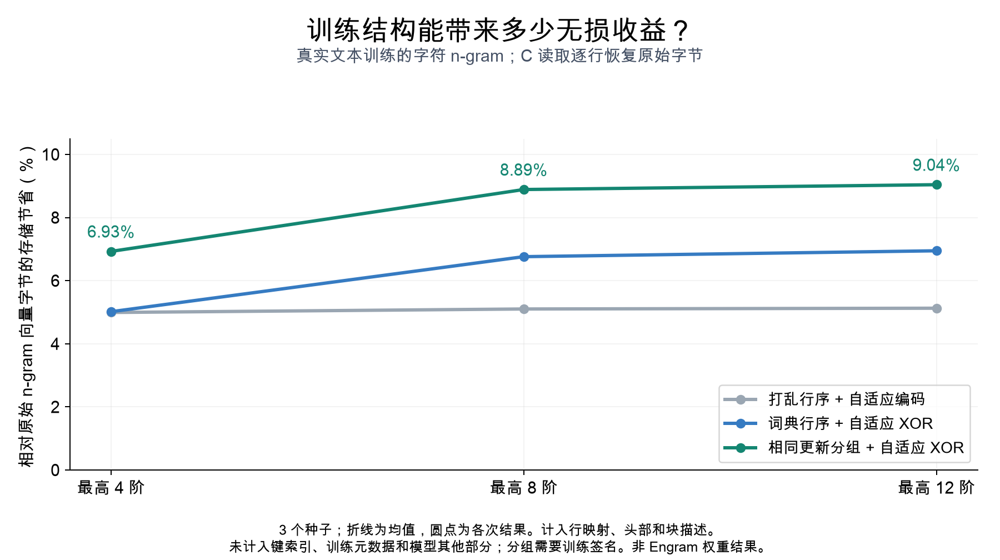
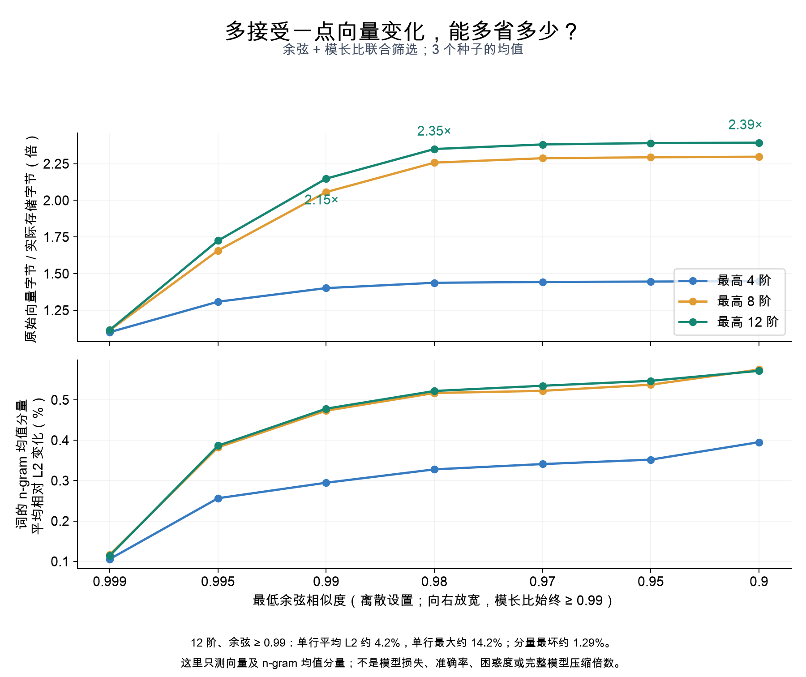

# Engram 之后，高阶 n-gram 记忆还能压缩多少？一次可复现的存储实验

DeepSeek 的 Engram 把一个老问题重新放到了大模型面前：当模型拥有越来越大的 n-gram 记忆表时，怎样把这些向量存得更紧凑，并按原来的 ID 正确取出来？

我在开源项目 **me_fasttext** 中研究这个问题。它从 FastText 的精确 n-gram 索引和紧凑存储出发，现在增加了独立的 C 行查询后端和 PyTorch CPU 适配器。这篇文章介绍训练结构、压缩结果，以及如何接入 Engram 风格的记忆查询。

先给出目前最值得复现的两个结果：

- **无损路线**：在公开文本训练的字符 n-gram 表上，按相同训练更新分组并使用自适应 XOR 编码，实际文件节省约 **6.9–9.1%**，C 查询逐行恢复原始字节。
- **近似路线**：最高 12 阶、余弦相似度和模长比都至少为 0.99 时，实际向量存储约缩小 **2.15 倍**。词的 n-gram 均值分量平均相对 L2 变化约 **0.48%**；单行平均变化约 **4.2%**，最大约 **14.2%**。

这些是小规模、真实文本训练的**字符 n-gram 参考实验**，没有真实 Engram 训练权重，也没有完整大模型准确率或困惑度结果。近似向量误差不能当作模型损失，文件压缩倍数也不能当作完整模型的内存缩减倍数。

代码和试用入口：[me_fasttext](https://github.com/initial-d/me_fasttext) · [Engram 接入快速指南](https://github.com/initial-d/me_fasttext/blob/main/docs/engram_quickstart.md)

## 1. 为什么我关注共同训练，而不是独立随机向量

在 FastText 风格训练里，一个词会展开成多个字符 n-gram。同一个词产生的这些片段会在同一次训练中被访问。如果两个片段出现在相同的一组词中，并且更新来源与次数一致，它们就有机会积累相似的训练信号。

例如，一个词内部的长片段及它的前后缀，可能多次共同出现。随着阶数提高，部分片段变得更专属于某个词，共同更新的结构也可能更集中。这给存储优化提供了一个可测的假设：**相同更新形成的相关性，能否转化成更小的存储？**

但“拥有相同前缀或后缀”还不足以推出“余弦一定超过 0.99”。短片段可能在很多其他词中出现，接收完全不同的额外更新；初始化、负采样、训练阶段也会影响结果。必须区分结构相关的片段和更新来源、次数完全相同的片段。

为此，我用 TinyShakespeare 公开英文文本训练精确字符 n-gram SGNS 参考：最高阶数 4、8、12，每种设置使用 3、7、11 三个种子，共 9 张表。向量维度 128，保留 1,200 个高频词，每次训练 2,000 步、512,000 个训练对，使用 CPU 单线程。语料和训练报告都有固定哈希；本文不重新分发语料或权重。

结果中，更新来源和次数完全相同的结构组合，余弦中位数约为 **0.996**，约 **85.9–89.4%** 达到 0.99。这类组合在结构组合中的占比，从最高 4 阶的 **21.8%** 上升到最高 12 阶的 **59.4%**。

这支持“高阶结构值得研究”的方向。它还不是普遍规律：词表较小，机会在 12 阶附近已经明显趋于饱和；token n-gram、哈希碰撞和其他语言还需要各自验证。

独立随机向量在这里承担另一个用途：检查接口、低冗余输入和失败边界。它们不代表共同训练带来的压缩机会。

## 2. 无损压缩：高相似度不等于字节相同

这 9 张训练表中，所有向量行的字节都各不相同。直接做完全相同行去重，无法利用“余弦接近 1”这一点。

我的无损方案把相关行放到邻近位置，按块比较三种编码：原始字节、普通 zlib，以及“相邻行按位 XOR 后再 zlib”。每个块保留最小的候选。XOR 是可逆的位操作，解码不会引入浮点舍入，NaN 的具体位模式、正负零等也可以原样恢复。

行重新排序以后，再通过原始 ID 的映射表取回对应向量。查询者继续使用原来的 row ID，不需要理解磁盘上的新排列。



**图 1：**三个种子的实际结果，已计入文件头、完整行映射、块描述和压缩载荷。训练分组信息、键索引和模型其他部分不在这个分母中。

相同更新分组的自适应编码，在最高 4、8、12 阶分别节省约 **6.93%、8.89%、9.04%**。词典顺序也能提供一部分局部性；打乱行序的对照中没有选中 XOR 块，节省主要来自普通压缩，约为 5%。

这里的 9.04% 是相对原始浮点表的**总文件节省**，不是 XOR 相对 zlib 的额外节省。与相同布局的普通编码相比，XOR 在这些热查询中增加约 1.5–3.7% 的 p50 时间。节省存储和查询代价都需要报告。

这条路线已接入 C 读取后端，并非只估算压缩率。局限是：按相同更新分组需要训练元数据，而 Engram 的哈希桶不会自动提供这些签名。对其他输入，映射和描述开销还可能让完整文件大于原始表。

## 3. 如果接受近似，为什么要同时看余弦和模长比

余弦看方向，模长比看长度。两个向量方向一致但长度差很多，只看余弦会漏掉幅度变化；两个向量长度一样但方向相反，只看模长比也无法控制误差。

近似实验因此同时检查：

> cosine(x, y) ≥ 阈值；min(‖x‖, ‖y‖) / max(‖x‖, ‖y‖) ≥ 0.99。

候选来自已保留的严格前缀或后缀代表，每个原始向量都直接对照最后的代表，不通过多次传递合并隐藏误差。原始 ID 保留，向量本身会改变。



**图 2：**模长比固定至少 0.99，只放宽余弦。横轴是实际测试的离散设置。下图测的是词的 n-gram 均值分量，不是完整词向量或模型质量。

最高 12 阶、三个种子的均值如下：

| 最低余弦 | 原始向量字节 / 实际存储字节 | n-gram 均值分量平均相对 L2 | 最坏单词的分量误差 |
| --- | ---: | ---: | ---: |
| 0.999 | 1.116 倍 | 0.114% | 0.809% |
| 0.995 | 1.725 倍 | 0.386% | 1.288% |
| 0.99 | 2.148 倍 | 0.478% | 1.288% |
| 0.98 | 2.350 倍 | 0.522% | 3.791% |
| 0.97 | 2.381 倍 | 0.535% | 3.791% |
| 0.95 | 2.391 倍 | 0.547% | 5.341% |
| 0.90 | 2.393 倍 | 0.572% | 5.341% |

实际存储包含行映射、文件头、块描述、载荷和近似方案清单；分母只包含原始 n-gram 向量，不含词向量、输出层、键索引及模型其余参数。

**0.98 是这组实验的一个候选拐点**：继续放宽，压缩收益很少，尾部误差却明显增大。它适合进入下一步任务验证，不能直接作为所有模型的推荐参数。

还要特别注意，“余弦 0.99”不意味着“只有 1% 的误差”。即便两个等长向量的余弦为 0.99，相对 L2 距离也约为 √(2−2×0.99)，即 **14.1%**。所以我保留单行误差和聚合分量误差两套统计。12 阶联合 0.99 的单行平均 L2 约 4.2%，被合并的行平均约 8%，单行最大约 14.2%；不能用聚合后的 0.48% 遮住这些变化。

## 4. 一个 C 接口，怎样用于 Engram 或其他模型

模型框架和存储后端可以在 embedding gather 处连接：

> 模型计算原始 ID → PyTorch 适配器 → C 批量查询 → mmap 压缩块 → 写入输出张量 → 模型继续执行。

C 后端负责取行，PyTorch 负责张量接口；模型原有的投影、门控和后续计算继续使用取出的向量。对 Engram 的多头表，还要保留每个 head 的局部 ID、偏移、dtype 和输出形状。

例如，已经有一个冻结的 CPU 表时，可以这样导出并打开：

```python
from tools.engram_row_adapter import export_demo_embedding, open_demo_embedding

export_demo_embedding(original, head_sizes, "artifacts/layer-1",
                      backend="native", deduplicate=False, predictor="xor")
mapped = open_demo_embedding("artifacts/layer-1", head_sizes, embedding_dim,
                             native_library="build/libmeft_rows.so")
try:
    output = mapped(input_ids)
finally:
    mapped.close()
```

这里的 original、head_sizes、embedding_dim 和 input_ids 来自该层自己的冻结表和查询配置；macOS 使用 `.dylib`。完整构建、dtype 和生命周期要求见接入指南。它目前是不可训练的 CPU 适配器；CUDA、CPU→GPU 调度、绑权和完整 checkpoint 恢复仍需额外实现。

我已在固定版本的官方 Engram 演示模块中，验证 Python、native 和 native-XOR 三条路径，覆盖 float32、float16、bfloat16，共 9 个组合；原始表字节以及下游门控、ShortConv 输出一致。这些微型随机权重只验证接口。

另外，向上游提交了可选 embedding factory 的 [draft PR #27](https://github.com/deepseek-ai/Engram/pull/27)，用于创建时直接打开冻结表，避免先分配默认大表。截至 **2026-10-22，该 PR 仍未合并**。当前官方演示可以构造后替换；factory 示例需要固定版本的提议源码。这不是 DeepSeek 的采用或背书。

## 5. 从读文章到跑一次验证

Linux 上，从新目录开始：

```bash
git clone https://github.com/initial-d/me_fasttext.git
cd me_fasttext
python -m venv .venv
. .venv/bin/activate
python -m pip install torch numpy sympy transformers tokenizers
make native
curl -fL https://raw.githubusercontent.com/initial-d/Engram/8b4155c2f8fc886ef27973d1164b798126f90c0d/engram_demo_v1.py \
  -o /tmp/engram_factory_v1.py
python tools/demo_engram_factory.py \
  --proposal-source /tmp/engram_factory_v1.py \
  --native-library build/libmeft_rows.so \
  --output-dir artifacts/engram-factory
```

需要 C 编译器、Make 和 zlib 开发头文件。macOS 将构建命令换为 `make native NATIVE_SHARED=-dynamiclib NATIVE_EXT=dylib`，库路径换为 `build/libmeft_rows.dylib`。脚本会检查提议源码的 SHA256，不下载 tokenizer 或 checkpoint。

成功后得到 9 组接口验证结果，包括“默认表分配被阻止”以及全模块输出一致。想复现压缩率，需要另外按训练报告生成字符 n-gram 表；接口 demo 的随机权重不能证明上述压缩率。

## 6. 下一步最需要什么

现在最有价值的是一张**来源和许可明确的冻结 token n-gram 记忆表**，或一段可公开的真实 gather 轨迹。它能回答：共同更新结构能否延续到 Engram 哈希桶？随机与热点查询各付出多少代价？文件大小的收益能否转化成 RSS 和实际模型运行收益？

如果允许近似，还必须对完整模型测困惑度或任务指标，并与原始表、raw mmap 和量化等基线做同预算比较。没有这些结果，我会把当前工作定位为可运行的存储研究后端。

欢迎试用后通过 [集成问题入口](https://github.com/initial-d/me_fasttext/issues/new?template=evaluation-question.yml) 提交问题，或通过 [benchmark 模板](https://github.com/initial-d/me_fasttext/issues/new?template=benchmark-result.yml) 提交包含负面结果的复现。若这个方向与你有关，可以 star/watch 项目，方便跟进后续实测。

## 资料、复现与引用

- [项目代码](https://github.com/initial-d/me_fasttext)与 [Engram 快速指南](https://github.com/initial-d/me_fasttext/blob/main/docs/engram_quickstart.md)。
- [训练结构报告](https://github.com/initial-d/me_fasttext/blob/main/docs/trained_ngram_similarity_20261018.md)、[实际 native XOR 文件与查询](https://github.com/initial-d/me_fasttext/blob/main/docs/native_xor_compression_20261020.md)、[135 组近似实验及完整误差](https://github.com/initial-d/me_fasttext/blob/main/docs/approximate_ngram_compression_20261018.md)。
- [官方 CPU 模块验证](https://github.com/initial-d/me_fasttext/blob/main/docs/engram_full_adapter_verification_20261018.md)与 [C ABI / 模型接入边界](https://github.com/initial-d/me_fasttext/blob/main/docs/native_ngram_memory.md)。
- 原始论文：[Memory-Efficient FastText](https://arxiv.org/abs/2506.01254)。本文的 native 和 Engram 实验是后续软件工作，原论文没有报告这些新结果；引用时请同时标明对应软件提交和报告，见 [引用指南](https://github.com/initial-d/me_fasttext/blob/main/docs/citation_guide.md#cite-the-native-ngram-artifact)。

本文整理于 2026-10-22，代码基准提交为 `deab253ccef8e766ec1d41b78754d07dac23bf97`。图由仓库内原始汇总 JSON 重绘，无新训练；[绘图源码](https://github.com/initial-d/me_fasttext/blob/main/tools/plot_engram_launch.py)及[图表清单](https://github.com/initial-d/me_fasttext/blob/main/docs/engram_launch_20261022/figure_manifest.json)公开。原测量环境为 Python 3.12.14、PyTorch 2.14.1、NumPy 2.5.4、Apple M5 / 32 GiB、macOS 26.6.2、CPU 单线程；使用本地计算，无付费 API 或租用算力，未计量货币和能耗成本。各报告提供测量提交、完整命令、输入及文件哈希。
